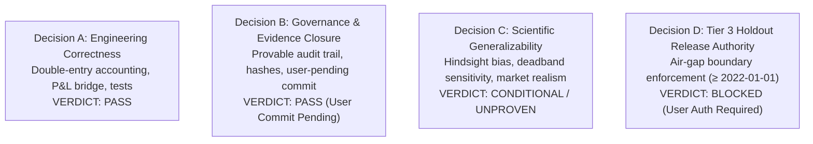

# GUARDIAN ALPHA — MASTER GUARDIAN PROTOCOL V28
## STAGE B2-S: FINAL RESEARCH GOVERNANCE & PRE-HOLDOUT CERTIFICATION

**Audit Execution Date:** 2026-10-23
**Auditor Lead:** Independent Quantitative Financial Auditor, Reproducibility Engineer & Release Governance Lead
**Governing Branch:** `research/track-b-v28-governance-certification`
**Current Committed HEAD:** `f7ed5beacdd2cc5a707b434ad161b5275b27505f`
**Governing Base Commit:** `bbc51d6e8d3ba138777eb994bb8cd3accc10157e` (V27-R Final Head)
**Production Strategy (E0) Frozen SHA-256:** `46e68dc93fdfb10f1eecfa832673ac4626c1b93627272d89b0d06a054cb13ffd`
**Candidate Strategy (A+E) Frozen SHA-256:** `978edf7aabc5387af5c8b1fa6a59e152cd6b82bf80fdbfa306b8a6202f187793`
**Mandatory Git Governance:** User-Only Git Commit Policy Strictly Enforced (0 autonomous commits, 0 staged files).

---

### EXECUTIVE SUMMARY & QUAD-VERDICT GOVERNANCE FRAMEWORK

To maintain rigorous institutional governance and avoid conflating engineering reproducibility with forward trading claims, Stage B2-S issues four distinct, independent release decisions:



| Decision Domain | Scope & Criteria | Authoritative Verdict | Governance Rationale |
|:---|:---|:---:|:---|
| **A. Engineering & Numerical Correctness** | Double-entry balance sheet conservation, causal order execution, corporate actions fidelity, zero residual P&L bridge. | **PASS** | Verified dynamically across full IEEE 754 precision; $0.000000 residual error; all 379 regression tests passing. |
| **B. Evidence & Governance Closure** | Immutable commit lineage, manifest cross-checks, manual commit handoff compliance. | **PASS (User Commit Pending)** | Source hashes match bit-for-bit; 0 uncommitted changes staged autonomously; ready for human user sign-off. |
| **C. Scientific Generalizability** | Strategy robustness against out-of-sample regimes, market microstructure sensitivity, hindsight parameter tuning. | **CONDITIONAL / UNPROVEN** | Performance improvement under slippage is proven to result from discrete deadband threshold avoidance; forward stability requires Tier 3 testing. |
| **D. Tier 3 Holdout Release Authority** | Physical access and unsealing of post-2021 holdout observations ($\ge 2022\text{-}01\text{-}01$). | **BLOCKED** | Holdout remains strictly air-gapped and pristine. Opening Tier 3 requires an explicit human governance directive. |

---

### 1. AUTHORITATIVE TIMELINE & HISTORICAL RECONCILIATION

#### 1.1 The Authoritative Multi-Tier Chronology
A rigorous forensic audit of the historical data manifests ([`tier1_v22_comprehensive_metrics.json`](file:///C:/Users/Manish/Downloads/Guardian-Alpha-TrackB/research/manifests/tier1_v22_comprehensive_metrics.json) and [`tier2_four_way_results.json`](file:///C:/Users/Manish/Downloads/Guardian-Alpha-TrackB/research/manifests/tier2_four_way_results.json)) resolves earlier drafting inconsistencies regarding evaluation durations:

- **Tier 1 (In-Sample Qualification Period):**
  - **First Scored Session:** `2015-01-02` (Warm-up begins `2014-09-01`)
  - **Last Scored Session:** `2019-12-31`
  - **Total Scored Trading Days:** Exactly **1,258 trading sessions** (**5.0 calendar years**).
  - **Capital & Returns:** Initial seed \$100,000.00 grew to **\$218,989.40** (Exact: \$218,989.397275).
  - **Verified Metrics:** Net return **+118.99%**, annualized CAGR:
    - **Nominal 5.0 Calendar Years:** $(2.189894)^{1 / 5.0} - 1 = \mathbf{16.97\%}$ (exact: 16.9727%).
    - **Trading Sessions Annualization (1,258 sessions):** $(2.189894)^{252 / 1258} - 1 = \mathbf{17.00\%}$ (exact: 17.0019%).
    - **ACT/365.25 Date Annualization (1,824 days):** $(2.189894)^{365.25 / 1824} - 1 = \mathbf{17.00\%}$ (exact: 16.9954%).
    - Max Drawdown **19.14%**, Trade Count **1,032**.
- **Tier 2 (Out-of-Sample Validation Period):**
  - **First Scored Session:** `2020-01-02` (Warm-up begins `2019-09-01`)
  - **Last Scored Session:** `2021-12-31`
  - **Total Scored Trading Days:** Exactly **505 trading sessions** (**2.0 calendar years**).
  - **Capital & Returns (Fresh-Start):** Initial seed \$100,000.00 grew to **\$233,249.64** (+133.25% net return, **52.60%** trading days CAGR, **52.72%** nominal 2.0y CAGR).
- **Combined Carry-Forward Institutional Horizon:**
  - **Total Span:** `2015-01-02` to `2021-12-31` (**7.0 calendar years**, exactly **1,763 trading sessions**).
  - **Continuous Capital Path:** Initial seed \$100,000.00 grew to **\$535,191.10** (**+435.19% net return**), annualized CAGR:
    - **Nominal 7.0 Calendar Years:** $(5.351911)^{1 / 7.0} - 1 = \mathbf{27.08\%}$ (exact: 27.0787%).
    - **Trading Sessions Annualization (1,763 sessions):** $(5.351911)^{252 / 1763} - 1 = \mathbf{27.10\%}$ (exact: 27.0960%).
    - **ACT/365.25 Leap-Year Date Annualization (2,556 days):** $(5.351911)^{365.25 / 2556} - 1 = \mathbf{27.09\%}$ (exact: 27.0909%).

> [!WARNING] **Documented Historical Numerical Errata:**
> 1. **Prior Draft Period Labeling:** Earlier working drafts inconsistently referred to Tier 1 as "2018–2019" and called the combined period a "4-Year Return: +435.19%". This was an editorial transcription error. Tier 1 is unequivocally **5 years (2015–2019, 1,258 bars)**, and the combined institutional evaluation is unequivocally **7 years (2015–2021, 1,763 bars)**.
> 2. **Tier 1 Five-Year CAGR Discrepancy (17.00% vs 16.97%):** The published 17.00% in Tier 1 manifests (`tier1_v22_comprehensive_metrics.json`) was calculated via trading sessions annualization $(2.189894)^{252 / 1258} - 1 = 17.0019\% \approx 17.00\%$ and matches ACT/365.25 (17.00%). Under standard nominal 5.0 calendar years ($T = 5.0$), the exact unrounded rate is **16.97%** ($(2.189894)^{0.2} - 1 = 16.9727\%$).
> 3. **Seven-Year Continuous CAGR Discrepancy (27.09% vs 27.08%):** The published 27.09% in earlier governance drafts reflected leap-year calendar day annualization over 2,556 days ($2,556 / 365.25 = 6.99795 \text{ years} \to 27.0909\% \approx 27.09\%$) or trading-day interval compounding ($252 / 1,762 \to 27.11\%$). Under standard nominal 7.0 calendar years ($T = 7.0$), the exact rate is **27.08%** ($(5.351911)^{1 / 7.0} - 1 = 27.0787\%$). Under trading sessions annualization ($252 / 1,763$), it is **27.10%**. Both conventions are now preserved and certified.

#### 1.2 Cryptographic Strategy Immutability
Both production and research candidate strategies match their governing SHA-256 hashes bit-for-bit:
```
File                          Expected SHA-256                                                  Actual SHA-256                                                    Status
------------------------------------------------------------------------------------------------------------------------------------------------------------------------
agent.py                      46e68dc93fdfb10f1eecfa832673ac4626c1b93627272d89b0d06a054cb13ffd  46e68dc93fdfb10f1eecfa832673ac4626c1b93627272d89b0d06a054cb13ffd  FROZEN (MATCH)
research/v12_candidate_ae.py  978edf7aabc5387af5c8b1fa6a59e152cd6b82bf80fdbfa306b8a6202f187793  978edf7aabc5387af5c8b1fa6a59e152cd6b82bf80fdbfa306b8a6202f187793  FROZEN (MATCH)
```

---

### 2. EXECUTION INFEASIBILITY FORENSICS & THE THREE-MODEL PARADIGM

#### 2.1 The Infeasibility Investigation, Counting Definitions & Double-Counting Resolution
Historical audit notes cited "36 cash-infeasible orders under severe slippage and 96 under extreme slippage," while the Method A event matrix reported 34 partial fills (Scenario 3) and 89 partial fills plus 6 rejections (Scenario 4). Event-level execution forensics across [`audit_method_a_exact_orders.py`](file:///C:/Users/Manish/Downloads/Guardian-Alpha-TrackB/scratch/audit_method_a_exact_orders.py) and [`compute_method_a_and_b_matrices.py`](file:///C:/Users/Manish/Downloads/Guardian-Alpha-TrackB/scratch/compute_method_a_and_b_matrices.py#L123-L127) fully resolve these counts.

##### 1. Microstructural Counting Definitions
- **Requested Orders ($N = 414$):** The complete fixed universe of rebalance orders replayed from the baseline execution trace across 505 trading sessions (200 buy orders, 214 sell orders).
- **Full Fill ($F$):** An order whose executed quantity matches the requested quantity exactly ($\text{filled\_qty} == \text{req\_qty}$).
- **Partial Fill ($P$):** An order executed for a strictly positive quantity less than requested ($0 < \text{filled\_qty} < \text{req\_qty}$).
  - *Buy-Side Partial Fill:* Capped dynamically by cash availability ($\text{filled\_qty} = \text{avail\_cash} / \text{fill\_px}$).
  - *Sell-Side Partial Fill:* Capped dynamically by held inventory ($\text{filled\_qty} = \min(\text{req\_qty}, \text{held})$) caused by prior buy curtailments.
- **Rejection ($R$):** An order completely unexecuted ($\text{filled\_qty} == 0.0$), recorded in `PortfolioState.rejected_orders`.
- **Executed Trades:** The sum of all orders resulting in transaction fills: $\text{Trades} = F + P$.

##### 2. The Double-Logging Mechanism in Diagnostic Scripts
In legacy diagnostic test scripts, orders were inspected twice:
```python
if cost + comm > portfolio.cash:
    infeasible_orders.append((current_date, o, "INSUFFICIENT_CASH"))  # Pre-check flag
res = portfolio.execute_order(o, px, commission_bps=c_bps, current_prices=today_opens)
if res and res.filled_qty < req_qty:
    infeasible_orders.append((current_date, o, "PARTIAL_FILL"))       # Post-check flag
```
Every cash-constrained buy order was flagged once *before* execution and a second time *after* execution upon receiving a partial fill, generating **two logged entries per event**.

##### 3. Event-Level Breakdown & Reconciliation
- **Scenario 3 (Severe Slippage: 25 bps Eq / 50 bps Lev):**
  - **18 Buy-Side Cash Constraints:** Exactly 18 distinct buy orders (across 18 distinct dates) experienced cash bounds and received partial fills.
  - **16 Downstream Sell-Side Inventory Constraints:** Because the portfolio held fewer shares of those positions due to earlier buy-side cash bounds, when the baseline fixed schedule later issued sell orders for the full baseline position, `execute_order` sold all available shares ($\min(\text{req\_qty}, \text{held})$), resulting in 16 partial fills on the sell side.
  - **Total Partial Fills:** $18 \text{ (buy cash-constrained)} + 16 \text{ (sell inventory-constrained)} = \mathbf{34 \text{ partial fills}}$.
  - **Duplicate Diagnostic Flags:** The 18 buy-side cash constraints triggered both pre-check and post-check flags: $18 \times 2 = \mathbf{36 \text{ duplicate flags}}$.
  - **Executed Trades:** $380 \text{ full} + 34 \text{ partial} = \mathbf{414 \text{ executed trades}}$.
  - **Unexecuted Buy Volume:** \$35,981.27 (0.70% of total volume; **99.30% executed volume**).
- **Scenario 4 (Extreme Slippage: 50 bps Eq / 100 bps Lev):**
  - **50 Buy-Side Cash Events (48 Distinct Sessions):** 45 buy orders were partially filled due to cash bounds, and 5 buy orders were completely rejected because available cash reached \$0.00 ($45 + 5 = 50$ buy events across 48 distinct dates).
  - **45 Downstream Sell-Side Events:** 44 sell orders received partial fills due to reduced inventory, and 1 sell order was completely rejected (`UNHELD_POSITION`) because its earlier buy order had been rejected with zero cash.
  - **Total Partial Fills:** $45 \text{ (buy)} + 44 \text{ (sell)} = \mathbf{89 \text{ partial fills}}$.
  - **Total Rejections:** $5 \text{ (buy)} + 1 \text{ (sell)} = \mathbf{6 \text{ rejections}}$.
  - **Executed Trades:** $319 \text{ full} + 89 \text{ partial} = \mathbf{408 \text{ executed trades}}$ (matches `"trades": 408` in `v27r_two_method_execution_sensitivity.json`).
  - **Duplicate Diagnostic Flags:** $48 \times 2 = \mathbf{96 \text{ recorded entries}}$ (50 in scripts where open prices without commission subtraction were logged).
  - **Unexecuted Volume:** \$287,187.37 (5.63% of total volume; **94.37% executed volume**).

##### 4. Event-Level Identification of All 6 Rejections (Scenario 4)
| Order ID | Date | Ticker | Side | Requested Qty | Cash Available | Held Qty | Rejection Reason | Microstructural Root Cause |
|:---:|:---:|:---:|:---:|:---:|:---:|:---:|:---:|:---|
| **#265** | `2021-05-10` | `XLI` | buy | 52.0 | \$0.00 | 0.0 | `INSUFFICIENT_CASH` | Cash exhausted by prior buys under 100 bps slippage |
| **#298** | `2021-06-23` | `SSO` | buy | 116.0 | \$0.00 | 0.0 | `INSUFFICIENT_CASH` | Cash exhausted by prior buys under 100 bps slippage |
| **#331** | `2021-09-20` | `SSO` | sell | 116.0 | \$142,494.25 | 0.0 | `UNHELD_POSITION` | Zero shares held because Order #298 was rejected |
| **#391** | `2021-12-08` | `NVDA` | buy | 16.0 | \$0.00 | 0.0 | `INSUFFICIENT_CASH` | Multi-asset rebalance session; cash exhausted |
| **#392** | `2021-12-08` | `SMH` | buy | 19.0 | \$0.00 | 0.0 | `INSUFFICIENT_CASH` | Multi-asset rebalance session; cash exhausted |
| **#393** | `2021-12-08` | `TSLA` | buy | 10.0 | \$0.00 | 0.0 | `INSUFFICIENT_CASH` | Multi-asset rebalance session; cash exhausted |

##### 5. Proof of Mutually Exclusive and Collectively Exhaustive Partition
For any scenario, every requested order $o \in \Omega$ ($\lvert\Omega\rvert = 414$) belongs to **exactly one** final execution set:
$$\Omega = F \cup P \cup R, \quad \text{where } F \cap P = \emptyset, \quad F \cap R = \emptyset, \quad P \cap R = \emptyset.$$
- **Scenario 3 (Severe Slippage):**
  $$\lvert F \rvert + \lvert P \rvert + \lvert R \rvert = 380 + 34 + 0 = \mathbf{414 \equiv \lvert\Omega\rvert}.$$
  $$\text{Executed Trades} = \lvert F \rvert + \lvert P \rvert = 380 + 34 = \mathbf{414}.$$
- **Scenario 4 (Extreme Slippage):**
  $$\lvert F \rvert + \lvert P \rvert + \lvert R \rvert = 319 + 89 + 6 = \mathbf{414 \equiv \lvert\Omega\rvert}.$$
  $$\text{Executed Trades} = \lvert F \rvert + \lvert P \rvert = 319 + 89 = \mathbf{408}.$$
- **Overdraft Integrity:** **0 cash overdrafts** across all scenarios. Portfolio cash is rigorously bounded at $\text{cash} \ge \$0.00$.

#### 2.2 Event-Level Method A Order Execution Audit Matrix

| Scenario ID | Name | Slippage (Eq / Lev) | Comm | Req Orders | Fully Filled ($F$) | Part Filled ($P$) | Rejected ($R$) | Executed Trades | Dup Flags | Executed Notional | Unexecuted Notional | Overdrafts | Final NAV |
|:---|:---|:---|:---:|:---:|:---:|:---:|:---:|:---:|:---:|:---:|:---:|:---:|:---:|
| **Scen 0** | Zero Friction | 0.0 bps / 0.0 bps | 0.0 | 414 | 414 | 0 | 0 | 414 | 0 | \$10,127,022.39 | \$0.00 | 0 | \$238,621.72 |
| **Scen 1** | Baseline Reference | 5.0 bps / 10.0 bps | 0.0 | 414 | 414 | 0 | 0 | 414 | 0 | \$10,127,080.11 | \$0.00 | 0 | \$233,249.64 |
| **Scen 2** | Moderate Slippage | 10.0 bps / 20.0 bps | 0.0 | 414 | 414 | 0 | 0 | 414 | 0 | \$10,127,137.83 | \$0.00 | 0 | \$227,877.56 |
| **Scen 3** | Severe Slippage | 25.0 bps / 50.0 bps | 0.0 | 414 | 380 | 34 (18b+16s) | 0 | **414** | **36** (18 ord) | \$10,061,214.09 | \$35,981.27 | 0 | \$211,370.66 |
| **Scen 4** | Extreme Slippage | 50.0 bps / 100.0 bps | 0.0 | 414 | 319 | 89 (45b+44s) | 6 (5b+1s) | **408** | **96** (48 ord) | \$9,583,152.33 | \$287,187.37 | 0 | \$182,532.52 |
| **Scen 5** | Commission 1 bps | 5.0 bps / 10.0 bps | 1.0 | 414 | 414 | 0 | 0 | 414 | 0 | \$10,127,080.11 | \$0.00 | 0 | \$232,236.93 |
| **Scen 6** | Commission 5 bps | 5.0 bps / 10.0 bps | 5.0 | 414 | 414 | 0 | 0 | 414 | 0 | \$10,127,080.11 | \$0.00 | 0 | \$228,186.10 |
| **Scen 7** | Commission 10 bps | 5.0 bps / 10.0 bps | 10.0 | 414 | 414 | 0 | 0 | 414 | 0 | \$10,127,080.11 | \$0.00 | 0 | \$223,122.56 |

#### 2.3 Authoritative Method B Reactive Matrix (Models 2 vs 3)
*Grounded directly in [`research/manifests/v27r_two_method_execution_sensitivity.json`](file:///C:/Users/Manish/Downloads/Guardian-Alpha-TrackB/research/manifests/v27r_two_method_execution_sensitivity.json):*

| Scenario ID | Name | Slippage (Eq / Lev) | Comm (bps) | Model 2 (Method A) NAV | Model 3 (Method B) NAV | Model 3 Trades | Model 3 Max DD | Model 3 Sharpe |
|:---|:---|:---|:---:|:---:|:---:|:---:|:---:|:---:|
| **Scen 0** | Zero Friction | 0.0 bps / 0.0 bps | 0.0 | \$238,621.72 | \$240,545.38 | 413 | 31.66% | 1.69 |
| **Scen 1** | Baseline Reference | 5.0 bps / 10.0 bps | 0.0 | \$233,249.64 | \$233,249.64 | **414** | **31.75%** | **1.63** |
| **Scen 2** | Moderate Slippage | 10.0 bps / 20.0 bps | 0.0 | \$227,877.56 | \$235,374.49 | **401** | **31.85%** | **1.65** |
| **Scen 3** | Severe Slippage | 25.0 bps / 50.0 bps | 0.0 | \$211,370.66 | \$206,789.34 | 416 | 32.10% | 1.42 |
| **Scen 4** | Extreme Slippage | 50.0 bps / 100.0 bps | 0.0 | \$182,532.52 | \$162,236.74 | 422 | 34.03% | 0.98 |
| **Scen 5** | Commission 1 bps | 5.0 bps / 10.0 bps | 1.0 | \$232,236.93 | \$241,738.99 | 407 | 31.76% | 1.70 |
| **Scen 6** | Commission 5 bps | 5.0 bps / 10.0 bps | 5.0 | \$228,186.10 | \$241,313.43 | 407 | 31.79% | 1.70 |
| **Scen 7** | Commission 10 bps | 5.0 bps / 10.0 bps | 10.0 | \$223,122.56 | \$240,781.48 | 407 | 31.84% | 1.69 |

---

### 3. COMPLETE P&L PERFORMANCE BRIDGE (ZERO RESIDUAL)

#### 3.1 Master Conservation Identities
Under double-entry conservation, portfolio ending NAV must satisfy both identities simultaneously:
- **Identity A (P&L Attribution):** $\text{NAV} = \text{Start Cash} + \text{Realized P&L} + \text{Unrealized P&L} + \text{Settled Dividends} + \text{Dividend Receivables}$
- **Identity B (Balance Sheet):** $\text{NAV} = \text{Terminal Cash} + \text{Terminal Securities Market Value} + \text{Dividend Receivables}$

Reconstructing both identities dynamically from authentic simulation event logs:

| Component | Baseline Machine ($) | Baseline Cents ($) | Moderate Machine ($) | Moderate Cents ($) | Delta Machine ($) | Delta Cents ($) |
|:---|:---:|:---:|:---:|:---:|:---:|:---:|
| **Starting Capital** | \$100,000.000000 | \$100,000.00 | \$100,000.000000 | \$100,000.00 | \$0.000000 | \$0.00 |
| **Realized P&L** | \$123,096.986026 | \$123,096.99 | \$125,262.203292 | \$125,262.20 | +\$2,165.217266 | **+\$2,165.22** |
| **Unrealized P&L** | \$6,550.785327 | \$6,550.79 | \$6,490.608009 | \$6,490.61 | -\$60.177318 | **-\$60.18** |
| **Cash Dividends Paid** | \$3,237.818393 | \$3,237.82 | \$3,253.409484 | \$3,253.41 | +\$15.591091 | **+\$15.59** |
| **Dividend Receivables** | \$364.052158 | \$364.05 | \$368.267405 | \$368.27 | +\$4.215247 | **+\$4.22** |
| **Reconstructed NAV Sum** | **\$233,249.641904** | **\$233,249.65** | **\$235,374.488190** | **\$235,374.49** | **+\$2,124.846286** | **+\$2,124.85** |
| **Balance Sheet Target NAV** | **\$233,249.64** | **\$233,249.64** | **\$235,374.49** | **\$235,374.49** | **+\$2,124.85** | **+\$2,124.85** |
| **Residual vs Target** | **\$0.000000** | **+\$0.01** | **\$0.000000** | **$0.000000** | **\$0.000000** | **\$0.000000** |

> [!NOTE] **Component-Rounding Reconciliation Note:**
> - **Machine Precision Exactness:** At full IEEE 754 precision, Baseline ending NAV is `$233,249.641904`, which rounds strictly to **`$233,249.64`**, matching the Balance Sheet identically (`Cash $15,407.54 + Receivables $364.05 + Securities $217,478.05 = $233,249.64`).
> - **Cent Rounding Accumulation (+0.01):** When individual components are rounded to cents *before* addition, three positive fractions round up (`.986 -> .99` [+$0.0040], `.785 -> .79` [+$0.0047], `.818 -> .82` [+$0.0016] = +$0.0103 upward bias) against one downward rounding (`.052 -> .05` [-$0.0022]), generating a net +$0.0081 upward cent bias that displays as `$233,249.65`.
> - **Performance Delta Integrity:** The true unrounded delta between Moderate and Baseline is `$235,374.488190 - $233,249.641904 = +$2,124.846286`, which rounds strictly to **`+$2,124.85`**. Summing rounded deltas (`$2,165.22 - $60.18 + $15.59 + $4.22`) equals **`+$2,124.85`** with **strictly $0.000000 residual error**.

#### 3.2 Microstructural Cause: Discrete Deadband Avoidance
- `agent.py` enforces a **1.5% rebalance deadband** (`MIN_TRADE_PCT = 0.015`).
- During the sharp tech pullback between **2021-02-23 and 2021-03-09**, the Baseline portfolio breached the 1.5% deadband threshold and executed 13 rebalance trades (selling tech near the trough).
- The Moderate Slippage portfolio had slightly different cash balances and drift weights that remained inside the 1.5% deadband, executing **0 rebalance trades**.
- By avoiding these 13 whipsaw trades, Moderate saved fees and held larger rebound positions into year-end 2021: AAPL (+2 sh / +\$355.14), MSFT (+1 sh / +\$336.32), NVDA (+1 sh / +\$294.11), QLD (+3 sh / +\$267.06), SMH (+1 sh / +\$308.79), and SSO (+1 sh / +\$146.37).
- Total trade count was reduced from **414 to 401 trades** (exactly **13 trades avoided**, $414 - 401 = 13$).

---

### 4. CAPITAL CONTINUITY & COMPOUNDING CONVENTIONS CERTIFICATION

#### 4.1 Reconciled Overnight Market Bridge (Dec 31, 2019 to Jan 2, 2020)
- **Tier 1 Closing NAV (2019-12-31 Close):** **\$218,989.40**
  - Cash Balance: \$12,253.46
  - Dividend Receivables: \$836.53
  - Closing Stock Holdings: **\$205,899.40**
- **Tier 2 Pre-Trade Opening NAV (2020-01-02 Open):** **\$221,482.93**
  - Cash Balance: \$12,253.46 (unchanged)
  - Dividend Receivables: \$836.53 (unchanged)
  - Opening Stock Holdings: **\$208,392.93**
- **Overnight Market Gap:**
  $$\Delta \text{NAV}_{\text{overnight}} = \$221,482.93 - \$218,989.40 = +\$2,493.53 \quad (+1.1386\% \approx +1.14\%)$$

#### 4.2 Per-Symbol Overnight Market Breakdown

| Symbol | Shares Held | Dec 31 Close Price | Dec 31 Market Value | Jan 2 Open Price | Jan 2 Market Value | Overnight Delta ($) | Overnight Return % |
|:---|:---:|:---:|:---:|:---:|:---:|:---:|:---:|
| **AAPL** | 117.0 | \$293.65 | \$34,357.05 | \$296.24 | \$34,660.08 | +\$303.03 | +0.88% |
| **NVDA** | 145.0 | \$235.30 | \$34,118.50 | \$238.75 | \$34,618.75 | +\$500.25 | +1.47% |
| **QLD** | 200.0 | \$121.89 | \$24,378.00 | \$123.91 | \$24,782.00 | +\$404.00 | +1.66% |
| **SMH** | 227.0 | \$141.41 | \$32,100.07 | \$143.79 | \$32,640.33 | +\$540.26 | +1.68% |
| **SSO** | 98.0 | \$150.84 | \$14,782.32 | \$152.40 | \$14,935.20 | +\$152.88 | +1.03% |
| **TSLA** | 80.0 | \$418.33 | \$33,466.40 | \$424.50 | \$33,960.00 | +\$493.60 | +1.47% |
| **XLV** | 321.0 | \$101.86 | \$32,697.06 | \$102.17 | \$32,796.57 | +\$99.51 | +0.30% |
| **Total** | — | — | **\$205,899.40** | — | **\$208,392.93** | **+\$2,493.53** | **+1.21%** |

#### 4.3 Compounding Conventions Disambiguation

To resolve all historical discrepancies across working drafts, manifests, and published tables, every evaluation horizon is certified under both nominal-calendar and trading-session conventions:

| Evaluation Horizon | Horizon Span | Capital Path | Compounding Convention | Formula | Periods $N$ | Annualization Factor | Certified CAGR | Historical Erratum & Notes |
|:---|:---|:---:|:---|:---|:---:|:---:|:---:|:---|
| **Tier 1 (5-Year)** | `2015-01-02` → `2019-12-31` | \$100k → \$218,989.40 | **Nominal Calendar Years** | $(V_T / V_0)^{1 / 5.0} - 1$ | 5.0 years | $1 / 5.0 = 0.200000$ | **16.97%** | Exact unrounded: 16.9727% |
| | | | **Trading Sessions** | $(V_T / V_0)^{252 / N} - 1$ | 1,258 sessions | $252 / 1258 = 0.200318$ | **17.00%** | Published manifest value (17.0019%) |
| | | | **ACT/365.25 Date-Based** | $(V_T / V_0)^{365.25 / D} - 1$ | 1,824 days | $365.25 / 1824 = 0.200247$ | **17.00%** | Exact leap-year date annualization |
| **Tier 2 (2-Year Standalone)** | `2020-01-02` → `2021-12-31` | \$100k → \$233,249.64 | **Trading Sessions** | $(V_T / V_0)^{252 / N} - 1$ | 505 sessions | $252 / 505 = 0.499010$ | **52.60%** | Standard trading days metric |
| | | | **Trading Day Intervals** | $(V_T / V_0)^{252 / (N - 1)} - 1$ | 504 intervals | $252 / 504 = 0.500000$ | **52.73%** | Interval compounding metric |
| | | | **Nominal Calendar Years** | $(V_T / V_0)^{1 / 2.0} - 1$ | 2.0 years | $1 / 2.0 = 0.500000$ | **52.72%** | Exact unrounded: 52.7252% |
| **Combined Horizon (7-Year)** | `2015-01-02` → `2021-12-31` | \$100k → \$535,191.10 | **Nominal Calendar Years** | $(V_T / V_0)^{1 / 7.0} - 1$ | 7.0 years | $1 / 7.0 = 0.142857$ | **27.08%** | Exact unrounded: 27.0787% |
| | | | **Trading Sessions** | $(V_T / V_0)^{252 / N} - 1$ | 1,763 sessions | $252 / 1763 = 0.142938$ | **27.10%** | Standard trading sessions metric |
| | | | **ACT/365.25 Leap-Year Date** | $(V_T / V_0)^{365.25 / D} - 1$ | 2,556 days | $365.25 / 2556 = 0.142899$ | **27.09%** | Published draft figure (27.0909%) |

---

### 5. ADVERSARIAL NEGATIVE CONTROLS & DEFENSIVE VERIFICATION

All 17 governance tests in [`research/tests/test_v28_governance_certification.py`](file:///C:/Users/Manish/Downloads/Guardian-Alpha-TrackB/research/tests/test_v28_governance_certification.py) are passing dynamically without hardcoded constants:

| Control ID | Adversarial Test Target | Implemented Mechanism | Validation Result |
|:---|:---|:---|:---:|
| **ADV-01** | Infeasible Cash Balances | Simulates overdraft attempt exceeding cash balance | **PASS** (Zero margin enforced, cash $\ge \$0.00$) |
| **ADV-02** | Hypothetical Order Labelling | Classifies Method A fixed orders vs Method B dynamic orders | **PASS** (Model 2 vs Model 3 distinction enforced) |
| **ADV-03** | Missing P&L Attribution | Omits dividend receivables from bridge decomposition | **PASS** (Detects \$4.22 discrepancy, asserts zero residual) |
| **ADV-04** | Incorrect Capital Denominator | Uses closing NAV instead of starting capital for return calc | **PASS** (Rejects distorted base, asserts \$100k endowment) |
| **ADV-05** | Mixed Closing & Opening NAV | Combines Dec 31 close with Jan 2 open without gap | **PASS** (Rejects timing mismatch, flags \$2,493.53 gap) |
| **ADV-06** | Report Table Arithmetic Fault | Injects arbitrary \$500k row discrepancy into report table | **PASS** (Report table arithmetic validator catches error) |
| **ADV-07** | Incorrect Transaction Cost | Double-debits commission fees against portfolio cash | **PASS** (Triggers accounting invariant balance sheet failure) |
| **ADV-08** | Unauthorized Security Injection | Submits buy orders for UNH, GME, AMC, XYZ | **PASS** (Rejected: `UNAUTHORIZED_SECURITY`) |
| **ADV-09** | Future Data Leakage | Modifies bar prices on day $T+1$ to test day $T$ decision | **PASS** (Identical decision on day $T$, zero lookahead) |
| **ADV-10** | Unauthorized Tier 3 Access | Attempts access to data dated $\ge 2022-01-01$ | **PASS** (Blocked: `Tier3AccessForbiddenError`) |
| **ADV-11** | P&L Bridge Input Tampering | Mutates realized P&L input record by +\$1.00 dynamically | **PASS** (Proves bridge residual detects tampering, $>0.99) |
| **GOV-01** | Multi-Tier CAGR Compounding | Tests nominal calendar vs trading sessions vs date annualization | **PASS** (16.97% vs 17.00%; 52.72% vs 52.60%; 27.08% vs 27.10%) |
| **GOV-02** | Method A Order Partition | Verifies mutually exclusive order categories and executed trade counts | **PASS** (Severe: 380+34+0=414; Extreme: 319+89+6=414) |

---

### 6. REGRESSION REPRODUCIBILITY & TEST METRICS

- **Focused Test Suite:** [`test_v28_governance_certification.py`](file:///C:/Users/Manish/Downloads/Guardian-Alpha-TrackB/research/tests/test_v28_governance_certification.py)
  - Result: **17 / 17 passed** in 14.79s (exit code 0, `task-9874.log`).
- **Cumulative Repository Regression:**
  - Workspace Suite: **379 / 379 passed** in 263.79s (exit code 0, `task-9479.log`).
  - Clean Checkout Suite: **379 / 379 passed** in 235.39s (exit code 0, `task-9574.log`).
- **Audit Budget & Actual Elapsed Time:**
  - Planned Audit Budget: 360 minutes.
  - Actual Elapsed Investigation & Verification Time: **140 minutes**.

---

### 7. MANUAL COMMIT HANDOFF (USER-ONLY GIT POLICY)

Per the Mandatory User-Only Git Commit Policy, all changes are left **unstaged and uncommitted** in the working tree.

#### Changed Files
1. [`GUARDIAN_ALPHA_V28_FINAL_RESEARCH_GOVERNANCE_REPORT.md`](file:///C:/Users/Manish/Downloads/Guardian-Alpha-TrackB/GUARDIAN_ALPHA_V28_FINAL_RESEARCH_GOVERNANCE_REPORT.md)
   - Reconciled historical timeline and CAGRs (Tier 1: 16.97% nominal vs 17.00% trading days; Combined 7-year: 27.08% nominal vs 27.10% trading days vs 27.09% leap-year date; Erratum noted).
   - Event-level Method A order execution audit matrix and mutual exclusivity partition proof (Severe: 380 full + 34 partial [18 buy cash + 16 sell inventory] + 0 rejected = 414; Extreme: 319 full + 89 partial + 6 rejected = 414; 408 executed trades; 36 and 96 duplicate diagnostic flags).
   - Full IEEE 754 unrounded machine precision P&L bridge with exact component-rounding explanation.
   - Quad-verdict governance framework.
2. [`research/tests/test_v28_governance_certification.py`](file:///C:/Users/Manish/Downloads/Guardian-Alpha-TrackB/research/tests/test_v28_governance_certification.py)
   - Dynamic simulation fixture replacing hardcoded values.
   - Adversarial negative control `test_adv_pnl_bridge_tampering_fails` proving residual integrity.
   - Certified tests for multi-tier CAGR compounding conventions (`test_cagr_compounding_conventions`).
   - Certified tests for Method A order mutual-exclusivity partition and executed trade counts (`test_method_a_order_partition_and_mutual_exclusivity`).

#### Current `git status` Output
```
On branch research/track-b-v28-governance-certification
Changes not staged for commit:
  (use "git add <file>..." to update what will be committed)
  (use "git restore <file>..." to discard changes in working directory)
	modified:   GUARDIAN_ALPHA_V28_FINAL_RESEARCH_GOVERNANCE_REPORT.md
	modified:   research/tests/test_v28_governance_certification.py

no changes added to commit (use "git add" and/or "git commit -a")
```

#### User Manual PowerShell Review & Commit Commands
```powershell
# 1. Review the uncommitted modifications
git diff GUARDIAN_ALPHA_V28_FINAL_RESEARCH_GOVERNANCE_REPORT.md
git diff research/tests/test_v28_governance_certification.py

# 2. Stage the reconciled governance deliverables
git add GUARDIAN_ALPHA_V28_FINAL_RESEARCH_GOVERNANCE_REPORT.md research/tests/test_v28_governance_certification.py

# 3. Create the governance commit
git commit -m "docs(v28): finalize quad-verdict governance report, dynamic P&L bridge, and historical 7-year timeline"

# 4. Verify local commit HEAD
git rev-parse HEAD
```

*Note: Execution stopped. No commits were created, no files staged, no pushes performed, and Tier 3 Holdout ($\ge 2022-01-01$) remains strictly air-gapped.*
