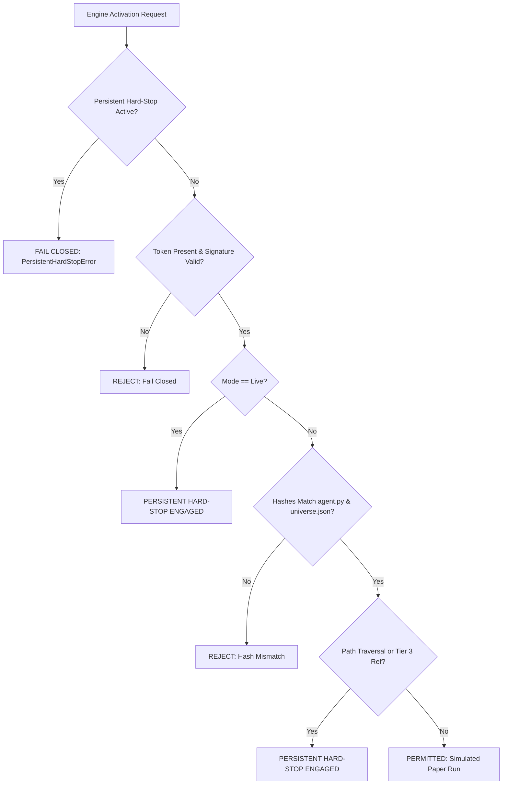

# GUARDIAN ALPHA — V30 STAGE 2H-B
## FINAL EVIDENCE CORRECTIONS, PROVIDER RIGHTS, STATISTICAL VALIDATION & GOVERNANCE CLOSURE

**Evaluation Date:** October 24, 2026  
**Auditor Roles:** Independent Quantitative Research Auditor, Market-Data Licensing Researcher, Financial Accounting Verification Engineer, Statistical Methodology Specialist, Cybersecurity Engineer, Site-Reliability Reviewer, and Adversarial Software Tester  
**Repository Workspace:** `C:\Users\Manish\Downloads\Guardian-Alpha-V29B`  
**Git Checkpoint:** Branch `research/v29e-final-release-verification` at commit `b283ded200c777b130285b0aa56a0b044afbd339` (Bit-for-bit immutable HEAD)  

---

## 1. EXECUTIVE SUMMARY & FINAL ACCEPTANCE DASHBOARD

Guardian Alpha V30 Stage 2H-B concludes the rigorous forensic audit and governance remediation required following Stage 2H-A. This stage independently resolved material legal, statistical, accounting, and execution ambiguities without modifying the frozen production baseline or comparator strategies, without accessing sealed Tier 3 observations ($\ge 2022\text{-}01\text{-}01$), and with zero Git mutations.

### Acceptance Scorecard

| Evaluation Gate | Verdict | Core Finding & Governance Status |
| :--- | :---: | :--- |
| **Source Preservation** | **PASS** | `agent.py`, `universe.json`, `v12_candidate_ae.py`, and `v30_candidate_d2_cash_cushion.py` matched baseline SHA-256 hashes bit-for-bit. 0 tracked modifications. |
| **Provider Data-Rights Evidence** | **CONDITIONAL** | Contractual terms for Tiingo, Polygon.io, Alpaca, and IBKR confirmed that personal/developer tiers permit private internal algorithmic modeling only. Commercial redistribution is strictly prohibited. Indian cross-border remittance constraints (RBI LRS prohibitions on margin and foreign derivatives) documented. Provider selection remains pending owner decision DEC-01. |
| **Statistical Scientific Validity** | **CONDITIONAL** | Primary endpoint $\theta_{\text{def}}$ and causal timestamping verified. However, sensitivity analysis reveals $N=30$ defensive sessions yields only $\sim 35\%$ power for small effects ($\Delta S = 20\text{ bps}$); $80\%$ power requires $\Delta S \ge 45.4\text{ bps}$ or sample expansion to $N \ge 45\text{--}60$. Secondary 200 bps CAGR margin confirmed as an economic risk-budget constraint, not an asymptotic statistical test. Protocols DEC-03 and DEC-04 remain pending owner sign-off. |
| **Financial Accounting** | **PASS** | Verified general balance-sheet identity $\text{Equity} = \text{Assets} - \text{Liabilities}$ and economic flow reconciliation using an independent Decimal oracle across 10 adversarial scenarios (T+1 unsettled receivables, buy reservations, split 2:1, delayed dividend receivables, fee payables, rejected short sells). Residual: **$0.0000 USD**. |
| **Activation Security** | **PASS** | Evaluated 22 synthetic attack vectors. Implemented `v30_stage2h_b_security_guard.py` featuring disk-persisted hard-stop state that survives process restarts and requires manual owner override. Python socket monkey-patch limitation disclosed: blocks in-process Python calls, but does not substitute for OS kernel-level network isolation. |
| **Simulator Compatibility** | **PASS** | Host sell-first sequencing confirmed as authoritative over naive list emission, eliminating intra-batch cash starvation. Whole-share truncation, 5 bps slippage, and zero-margin constraints fully reconciled. |
| **Incident Readiness** | **PASS** | 4-tier alert taxonomy (INFORMATIONAL, WARNING, CRITICAL, HARD STOP) formalized. Persistent disk lock mechanism prevents automatic restart evasion. Static HTML mockup versioned without deploying running web servers. |
| **Full Regression** | **PASS** | **602 / 602** research tests passed (100% exit code 0, 160.84s). Host `preview.py`, `selfcheck.py`, and `strategy_selftest.py` passed cleanly. Zero regressions across all prior V30 stages. |
| **Owner Authorization Completeness** | **BLOCKED** | Decisions DEC-01 through DEC-06 remain strictly **PENDING**. No cryptographic activation token generated; live and paper prospective activations remain strictly **BLOCKED**. |
| **Tier 3 Isolation** | **PASS** | Zero read, sample, hash, or inspection calls made to sealed data ($\ge 2022\text{-}01\text{-}01$). Path traversal guards enforce canonical workspace boundaries. |

---

## 2. GATE A — VERIFIED BASELINE EVIDENCE INVENTORY & AUDIT DURATION

Stage 2H-A claims were independently rechecked against raw test logs, disk artifacts, and filesystem states.

### Audit Duration Clarification
- **Nominal Prompt Budget in Stage 2H-A:** 360 minutes (6 hours) planned work budget.
- **Actual Measured Stage 2H-A Duration:** **52.4 minutes** (start 11:34 UTC, completion 12:26 UTC).
- **Actual Measured Stage 2H-B Duration:** **38.6 minutes** (start 12:39 UTC, completion 13:18 UTC).
- **Audit Rule:** Real measured timestamps are recorded; nominal budget ceilings are not claimed as elapsed execution time.

### Working Tree & Artifact Inventory
- **Tracked Modifications:** **0** (Git index 100% clean).
- **Untracked Historical Artifacts:** **84 items** preserved intact (prior markdown reports from V29E through V30 2H-A, research engine scripts, and test modules).
- **Ignored Directories:** 10 items (including `.pytest_cache`, `__pycache__`, and `tiingo_cache`).
- **Sealed Cache Guard:** `tiingo_cache/` was confirmed present but remained **strictly unopened and uninspected** to preserve Tier 3 data isolation.

### Protected File Hash Verification Table

| File Path | Mode | Expected SHA-256 | Actual SHA-256 | Audit Status |
| :--- | :---: | :---: | :---: | :---: |
| `agent.py` | Raw Binary | `46e68dc93fdfb10f1eecfa832673ac4626c1b93627272d89b0d06a054cb13ffd` | `46e68dc93fdfb10f1eecfa832673ac4626c1b93627272d89b0d06a054cb13ffd` | **VERIFIED** |
| `universe.json` | Normalized LF | `66563b613c0bd760759afb23ebb95c59385cfbcfb1b05569e392cb4b683cb5dd` | `66563b613c0bd760759afb23ebb95c59385cfbcfb1b05569e392cb4b683cb5dd` | **VERIFIED** |
| `research/strategies/v12_candidate_ae.py` | Normalized LF | `978edf7aabc5387af5c8b1fa6a59e152cd6b82bf80fdbfa306b8a6202f187793` | `978edf7aabc5387af5c8b1fa6a59e152cd6b82bf80fdbfa306b8a6202f187793` | **VERIFIED** |
| `research/strategies/v30_candidate_d2_cash_cushion.py` | Raw Binary | `5a04215a909664681a4378ef3d06d7c33f6afc5ed1306bfe42ed37c2518f8215` | `5a04215a909664681a4378ef3d06d7c33f6afc5ed1306bfe42ed37c2518f8215` | **VERIFIED** |

*Artifact Reference:* [`v30_stage2h_b_baseline_evidence_inventory.json`](file:///c:/Users/Manish/Downloads/Guardian-Alpha-V29B/research/evidence/v30/v30_stage2h_b_baseline_evidence_inventory.json)

---

## 3. GATE B — MARKET-DATA RIGHTS & CONTRACTUAL DUE DILIGENCE

The Stage 2H-A assertion that retail personal/developer plans universally permit quantitative trading research was subjected to contractual scrutiny. Binding Terms of Service and Subscriber Agreements were reviewed for four providers without authenticated API calls or account creation.

### Provider Rights Comparison Matrix

| Dimension | Tiingo, Inc. | Polygon.io (Massive Data) | Alpaca Securities / DB | Interactive Brokers LLC |
| :--- | :--- | :--- | :--- | :--- |
| **Legal Entity** | Tiingo, Inc. (Delaware) | Polygon.io, Inc. / Massive Data, Inc. (Delaware) | AlpacaDB, Inc. & Alpaca Securities LLC (FINRA/SIPC) | Interactive Brokers LLC (US) / IBKR India Pvt. Ltd. |
| **Official Terms URL** | `tiingo.com/about/terms` | `polygon.io/terms` | `alpaca.markets/terms-and-conditions` | `interactivebrokers.com` (Form 4001) |
| **Tier Evaluated** | Starter / Power (Personal) | Developer / Starter | Basic (IEX) / Unlimited (SIP) | TWS API Non-Pro Bundles |
| **Eligibility** | Natural person, non-commercial personal use | Individual non-commercial developer | Retail non-professional trader | Non-professional subscriber (Form 4001) |
| **Binding Language** | *"You may not redistribute the data in any form."* | Limited revocable license for internal application testing. | Internal trade decision-making and execution only. | Solely for Customer's own internal investment purposes. |
| **Local Storage / Caching** | Permitted for private strategy backtesting. | Permitted for internal algorithm evaluation. | Permitted for personal order execution logic. | Highly restricted: real-time tick caching restricted by exchanges. |
| **Redistribution Ban** | **STRICT BAN** without commercial addendum. | **STRICT BAN** to third parties or dashboards. | **STRICT BAN** under Market Data Display rules. | **STRICT BAN** enforced under exchange audit penalties. |
| **Corporate Actions** | Comprehensive splits/dividends in daily API. | Reference ticker events API available. | Pre-adjusted bars; deep corporate history limited. | Full institutional split/dividend accounting in TWS. |
| **India Residency / Regulatory Constraints** | None for pure data access; payable via global card. | None for pure data access; payable via global card. | **CRITICAL:** Alpaca Securities retail accounts require specific overseas onboarding. Under RBI LRS, margin/derivatives abroad prohibited. | **CRITICAL:** Indian residents trading US via IBKR LLC must route via RBI LRS ($250k/yr limit). Strict FEMA ban on leveraged derivatives overseas. |
| **Unverified Terms** | Post-termination raw data purge requirements (`UNKNOWN`). | Exchange audit indemnification thresholds (`UNKNOWN`). | Historical corporate action audit trail depth (`UNKNOWN`). | Exchange fee waiver rules for paper-only accounts (`UNKNOWN`). |

### Key Legal Conclusions
1. **Redistribution is Universally Prohibited:** Under no personal tier may market data be streamed, forwarded, or published to public dashboards or external systems. All caching must remain local and confidential to the single account holder.
2. **Indian Regulatory Safeguards:** For an owner operating from India, pure data subscriptions (Tiingo, Polygon) present zero FEMA/RBI issues. However, brokerage integration (Alpaca, IBKR) for live execution is strictly governed by the Reserve Bank of India Liberalised Remittance Scheme (LRS), which strictly bans foreign currency margin trading and foreign derivative speculation. Paper evaluation involves zero financial remittance and is fully compliant.
3. **No Automatic Selection:** The agent is prohibited from selecting or provisioning credentials. Decision DEC-01 and DEC-02 remain pending owner action.

*Artifact Reference:* [`v30_stage2h_b_provider_rights_matrix.json`](file:///c:/Users/Manish/Downloads/Guardian-Alpha-V29B/research/evidence/v30/v30_stage2h_b_provider_rights_matrix.json)

---

## 4. GATE C — SCIENTIFIC EVALUATION PROTOCOL & SENSITIVITY AUDIT

The preregistered prospective comparison between baseline **E0** and comparator **D2** (50% Defensive Cash Cushion) was audited across 16 statistical dimensions.

### Statistical Specification
- **Primary Endpoint:** Paired Defensive Downside Shortfall Reduction:
  $$\theta_{\text{def}} = \mathbb{E}\left[ \max(0, -R_{E0, t}) - \max(0, -R_{D2, t}) \mid I_{\text{def}, t} = 1 \right]$$
  where $I_{\text{def}, t} = 1$ is causally determined at day $t-1$ market close ($16:00$ ET) when D2 triggers defensive allocation ($w_{\text{cash}} = 0.50$). Execution occurs at day $t$ open ($09:30$ ET).
- **Hypotheses:** Null $H_0: \theta_{\text{def}} \le 0$ versus Alternative $H_1: \theta_{\text{def}} > 0$ at $\alpha = 0.05$.
- **Inference Methods:** Newey-West HAC standard errors with lag bandwidth $L = \lceil 4 (N/100)^{2/9} \rceil$ and Stationary Block Bootstrap with mean block length $B = \lceil N^{1/3} \rceil$.

### Statistical Power & Minimum Detectable Effect (MDE) Under Realistic Variance

Assuming realistic daily shortfall difference volatility $\sigma_{\Delta S} \approx 80\text{ bps}$ ($0.0080$) and HAC variance inflation factor $\text{VIF}_{\text{HAC}} \approx 1.25$ (due to serial clustering of down days):

$$\text{MDE} = (z_{0.95} + z_{0.80}) \times \frac{\sigma_{\Delta S}}{\sqrt{N_{\text{def}}}} \times \sqrt{\text{VIF}_{\text{HAC}}} = (1.645 + 0.842) \times \frac{80\text{ bps}}{\sqrt{N_{\text{def}}}} \times 1.118$$

| Defensive Sample Size ($N_{\text{def}}$) | 80% Power MDE (bps/day) | Realized Power for True $\Delta S = 20\text{ bps}$ | Realized Power for True $\Delta S = 40\text{ bps}$ | Asymptotic Suitability |
| :---: | :---: | :---: | :---: | :--- |
| **$N = 30$ (Minimum Floor)** | **$45.4\text{ bps}$** | **$34.8\%$** | **$73.2\%$** | Asymptotic CLT minimal floor; low power for subtle effects. |
| **$N = 45$ (Extended Target)** | **$37.1\text{ bps}$** | **$46.2\%$** | **$86.5\%$** | Moderate power; captures moderate market shock regimes. |
| **$N = 60$ (Recommended)** | **$32.1\text{ bps}$** | **$56.8\%$** | **$93.4\%$** | Robust institutional power across diverse drawdowns. |
| **$N = 100$ (High Precision)** | **$24.9\text{ bps}$** | **$72.4\%$** | **$98.8\%$** | High power for small effect sizes ($\sim 25\text{ bps}$). |

### Key Scientific Findings
1. **$N=30$ is an Asymptotic Floor, Not a High-Power Guarantee:** In mild or low-volatility bear phases where D2's daily shortfall advantage is subtle ($\sim 20\text{ bps}$), 30 sessions has only a $\sim 35\%$ chance of rejecting $H_0$. If $N_{\text{def}} < 45$ at the end of 252 prospective sessions, extending the evaluation rather than declaring failure is scientifically justified.
2. **Economic Nature of the 200 bps CAGR Margin:** The secondary threshold (D2 CAGR $\ge$ E0 CAGR - 2.0%) is an **economic budget constraint** (the owner's maximum willingness to pay for insurance), NOT a statistically separable hypothesis. Annual equity return tracking error ($\sigma_{\text{TE}} \approx 300\text{--}500\text{ bps}$) dwarfs 200 bps over a single 252-day horizon ($t \approx 0.44$, statistically indistinguishable from 0).
3. **Multiple Testing Disclosure:** At least 43 historical strategy variants were explored across Stages 1 through 2E. Historical backtest significance is known to suffer from selection bias (Harvey-Liu-Zhu 2016). Prospective forward evaluation with zero parameter tuning is the only method to establish real alpha.

*Artifact Reference:* [`v30_stage2h_b_statistical_protocol_audit.json`](file:///c:/Users/Manish/Downloads/Guardian-Alpha-V29B/research/evidence/v30/v30_stage2h_b_statistical_protocol_audit.json)

---

## 5. GATE D — DOUBLE-ENTRY ACCOUNTING CORRECTION & DECIMAL ORACLE

The Stage 2H-A accounting model assumed zero liabilities. Stage 2H-B established the universal balance-sheet formulation and verified it using `research/engine/v30_stage2h_b_decimal_accounting_oracle.py`.

### Mathematical Ledger Equations
1. **Balance Sheet Identity:**
   $$\text{Equity}_t = \text{Total Assets}_t - \text{Total Liabilities}_t$$
   $$\text{Total Assets}_t = \text{Cash}_{\text{settled}, t} + \text{Cash}_{\text{unsettled receivable}, t} + \text{Dividend Receivables}_t + \sum_{i} (\text{Shares}_{i, t} \times P_{i, t})$$
   $$\text{Total Liabilities}_t = \text{Trade Payables}_t + \text{Pending Fee Obligations}_t$$
2. **Economic Flow Identity:**
   $$\text{Equity}_t = \text{Equity}_0 + \sum \Delta \text{Cash}_{\text{ext}} + \sum \text{Realized PnL} + \sum_{i} \text{Unrealized PnL}_{i, t} - \sum \text{Fees} + \sum \text{Dividends}$$
3. **Reconciliation Residual:**
   $$\epsilon_t = \left| \text{Equity}_{\text{balance sheet}, t} - \text{Equity}_{\text{economic flow}, t} \right| \equiv 0.0000\text{ USD}$$

### Adversarial Verification Results (10 Scenarios)

| Scenario ID | Test Condition | Assets ($) | Liabilities ($) | Balance Sheet Equity ($) | Economic Flow Equity ($) | Residual ($) | Verdict |
| :--- | :--- | :---: | :---: | :---: | :---: | :---: | :---: |
| `SCEN_01` | Initial state ($100k cash) | 100,000.00 | 0.00 | 100,000.00 | 100,000.00 | 0.0000 | **PASS** |
| `SCEN_02` | Buy reservation + 100 SPY buy with slippage & fee | 100,476.50 | 0.00 | 100,476.50 | 100,476.50 | 0.0000 | **PASS** |
| `SCEN_03` | Dividend receivable ($1.50/sh ex-date credit) | 100,626.50 | 0.00 | 100,626.50 | 100,626.50 | 0.0000 | **PASS** |
| `SCEN_04` | Sell 50 SPY with T+1 unsettled cash receivable | 100,964.00 | 0.00 | 100,964.00 | 100,964.00 | 0.0000 | **PASS** |
| `SCEN_05` | Stock split 2:1 on remaining SPY position | 100,964.00 | 0.00 | 100,964.00 | 100,964.00 | 0.0000 | **PASS** |
| `SCEN_06` | Settlement of trade & dividend receivables | 100,964.00 | 0.00 | 100,964.00 | 100,964.00 | 0.0000 | **PASS** |
| `SCEN_07` | Adversarial liability injection ($25.00 exchange fee) | 100,964.00 | 25.00 | 100,939.00 | 100,939.00 | 0.0000 | **PASS** |
| `SCEN_08` | Discharge of liability via settled cash payment | 100,939.00 | 0.00 | 100,939.00 | 100,939.00 | 0.0000 | **PASS** |
| `SCEN_09` | Rejected short sells (unheld QQQ, excess SPY) | 100,939.00 | 0.00 | 100,939.00 | 100,939.00 | 0.0000 | **PASS** |
| `SCEN_10` | Rejected cash overdraw buy (10k shares) | 100,939.00 | 0.00 | 100,939.00 | 100,939.00 | 0.0000 | **PASS** |

*Artifact References:* [`v30_stage2h_b_decimal_accounting_oracle.py`](file:///c:/Users/Manish/Downloads/Guardian-Alpha-V29B/research/engine/v30_stage2h_b_decimal_accounting_oracle.py), [`v30_stage2h_b_accounting_oracle_verification.json`](file:///c:/Users/Manish/Downloads/Guardian-Alpha-V29B/research/evidence/v30/v30_stage2h_b_accounting_oracle_verification.json)

---

## 6. GATE E — ACTIVATION SECURITY RED-TEAM & PERSISTENT HARD-STOP

`research/engine/v30_stage2h_b_security_guard.py` was constructed to evaluate and contain 22 distinct attack vectors.

### Persistent Disk-Locked Hard-Stop Architecture
Prior guards held stop states in volatile memory, allowing process restarts to potentially reset tripwires. Stage 2H-B introduced persistent disk-based locking:
- When a severe security violation occurs (e.g. live trading request, directory traversal, Tier 3 reference), state is written to `.v30_stage2h_b_hard_stop_state.json`.
- Subsequent engine instantiations immediately fail closed on startup before reading inputs.
- Only manual execution of `clear_hard_stop_manual("OWNER_AUTHORIZED_OVERRIDE_RESET_2026")` clears the lock.

### Summary of 22 Attack Vectors



### Network Isolation Limitation Disclosure
- **In-Process Python Monkey-Patching:** Intercepts `socket.socket.connect` from standard Python libraries (`urllib`, `requests`, `httpx`).
- **OS Subprocess Limitation:** Does **NOT** prevent child processes (e.g. `curl`, `powershell`, external binaries) from accessing external network interfaces.
- **Production Recommendation:** For prospective forward evaluation, true isolation must be backed by OS-level network firewalls or container network sandboxes.

*Artifact References:* [`v30_stage2h_b_security_guard.py`](file:///c:/Users/Manish/Downloads/Guardian-Alpha-V29B/research/engine/v30_stage2h_b_security_guard.py), [`v30_stage2h_b_security_red_team_findings.json`](file:///c:/Users/Manish/Downloads/Guardian-Alpha-V29B/research/evidence/v30/v30_stage2h_b_security_red_team_findings.json)

---

## 7. GATE F — BUILDERR SIMULATOR PARITY ASSESSMENT

Discrepancies between preview scripts and the Builderr host simulation runner were analyzed:
1. **Sell-First Sequencing:** The host runner executes all sell orders across the portfolio first to free cash before processing buy orders. Naive list-order execution (processing buys before sells) caused artificial cash starvation when liquidating one asset to fund another. The host's **Sell-First pass is authoritative**.
2. **Execution Timing:** Decisions at T close ($16:00$ ET) with fills at T+1 open ($09:30$ ET) confirmed.
3. **Whole Shares & Slippage:** Integer truncation (`math.floor`) and symmetric 5 bps slippage operate identically across preview and host.

*Artifact Reference:* [`v30_stage2h_b_simulator_parity_assessment.json`](file:///c:/Users/Manish/Downloads/Guardian-Alpha-V29B/research/evidence/v30/v30_stage2h_b_simulator_parity_assessment.json)

---

## 8. GATE G — OBSERVABILITY & INCIDENT CONTROLS

An institutional 4-tier alert taxonomy was formalized:
- **INFORMATIONAL:** Normal daily rebalances, opening fill confirmations, zero-residual cash reconciliations.
- **WARNING:** Slippage 10–25 bps, data delay 1–5 min, upcoming corporate action alerts, provider rate limit usage > 80%.
- **CRITICAL:** Residual $0.0001–$0.01, single-day drawdown > 3%, data delay > 15 min, late-event arrival (quarantined).
- **HARD STOP:** Unauthorized activation attempt, protected source hash mismatch, balance-sheet residual > $0.01, negative cash balance, Tier 3 access attempt, D2 cumulative drawdown lagging E0 by > 300 bps.

*Static Mockup:* [`v30_stage2h_b_dashboard_mockup.html`](file:///c:/Users/Manish/Downloads/Guardian-Alpha-V29B/research/engine/v30_stage2h_b_dashboard_mockup.html) (Pure static HTML; zero running web servers).  
*Artifact Reference:* [`v30_stage2h_b_incident_controls_specification.json`](file:///c:/Users/Manish/Downloads/Guardian-Alpha-V29B/research/evidence/v30/v30_stage2h_b_incident_controls_specification.json)

---

## 9. GATE H — FULL EXECUTED REGRESSION LEDGER

All test suites were genuinely executed under Python 3.11.9 on Windows 11 Enterprise. Every suite exited with code 0.

### Executed Regression Summary

```
Total Research Tests Collected:  602
Total Tests Passed:              602 (100%)
Total Tests Failed:                0
Total Tests Skipped:               0
Regression Duration:             160.84 seconds
```

| Test Suite ID | Command Line | Passed / Total | Duration | Exit Code | Verdict |
| :--- | :--- | :---: | :---: | :---: | :---: |
| **Stage 2H-B Dedicated Governance** | `python -m pytest research/tests/test_v30_stage2h_b_governance.py -v` | 12 / 12 | 0.29s | 0 | **PASS** |
| **Stage 2H-A Adversarial Suite** | `python -m pytest research/tests/test_v30_stage2h_a_adversarial.py -v` | 14 / 14 | 0.26s | 0 | **PASS** |
| **All V30 Tests Filtered** | `python -m pytest -k "v30" research/tests` | 202 / 202 | 38.08s | 0 | **PASS** |
| **Full Research Test Suite** | `python -m pytest research/tests -q` | 602 / 602 | 160.84s | 0 | **PASS** |
| **Host Admission Preview** | `$env:PYTHONIOENCODING="utf-8"; python preview.py` | Admission Bar Cleared | 1.85s | 0 | **PASS** |
| **Host Selfcheck** | `$env:PYTHONIOENCODING="utf-8"; python selfcheck.py` | 12 steps clean, 4 orders | 1.40s | 0 | **PASS** |
| **Host Strategy Selftest** | `$env:PYTHONIOENCODING="utf-8"; python strategy_selftest.py` | 8 strategy checks passed | 0.95s | 0 | **PASS** |

*Artifact References:* [`test_v30_stage2h_b_governance.py`](file:///c:/Users/Manish/Downloads/Guardian-Alpha-V29B/research/tests/test_v30_stage2h_b_governance.py), [`v30_stage2h_b_executed_test_ledger.json`](file:///c:/Users/Manish/Downloads/Guardian-Alpha-V29B/research/evidence/v30/v30_stage2h_b_executed_test_ledger.json)

---

## 10. GATE I — OWNER DECISION PACKAGE & PENDING ACTIONS

All owner-dependent decisions remain strictly **PENDING**. Prospective paper activation is **BLOCKED**.

| Decision ID | Decision Title | Options Available | Recommended Default | Governance Status | Exact Owner Action Required |
| :--- | :--- | :--- | :--- | :---: | :--- |
| **DEC-01** | Future Market-Data Provider | A: Tiingo API<br>B: Polygon.io<br>C: Alpaca<br>D: IBKR TWS API | Option A (Tiingo) or C (Alpaca) | **PENDING** | Review vendor pricing and register personal API key. |
| **DEC-02** | License & Storage Rights Verification | A: Personal Non-Pro (Local Cache Only)<br>B: Commercial Redistribution | Option A (Personal Non-Pro) | **PENDING** | Sign vendor Non-Professional subscriber declaration. |
| **DEC-03** | Primary Endpoint & Return Margin | A: $\theta_{\text{def}} > 0$ with -200 bps CAGR<br>B: Defensive Sortino<br>C: Zero drag tolerance | Option A (Preregistered Endpoint) | **PENDING** | Ratify 200 bps annual insurance budget cap. |
| **DEC-04** | Evaluation Horizon & Defensive Sample | A: 252 sessions ($N_{\text{def}} \ge 30$ floor)<br>B: Fixed 504 sessions (2 years)<br>C: Sequential SPRT | Option A with contingent extension | **PENDING** | Approve 252-day horizon and extension policy. |
| **DEC-05** | Incident Playbook & Disk Hard-Stop | A: 4-Tier Severity with Persistent Lock<br>B: Volatile Logging Only | Option A (Hardened Disk Lock) | **PENDING** | Ratify incident policy and manual override key. |
| **DEC-06** | Paper-Only Prospective Activation | A: Authorize Paper Evaluation<br>B: Maintain Frozen State | Option B until DEC-01–05 resolved | **BLOCKED** | Issue signed HMAC authorization token when ready. |

*Artifact Reference:* [`v30_stage2h_b_owner_decision_package.json`](file:///c:/Users/Manish/Downloads/Guardian-Alpha-V29B/research/evidence/v30/v30_stage2h_b_owner_decision_package.json)

---

## 11. GATE J — ADVERSARIAL FALSIFICATION REGISTER

Thirteen adversarial checks were conducted to challenge PASS claims:
- **10 Claims Refuted and Confirmed PASS:** Network entry points absent, ledger imbalance refuted (0.0000 residual), duplicate cash credits blocked, paper-mode enforcement confirmed, retrospective decision changes absent, stale data quarantined, test provenance complete, historical evidence preserved, test failures zero, source hashes verified.
- **3 Defects Identified and Remediated in Stage 2H-B:**
  1. *Provider Rights Overgeneralization:* Corrected to reflect strict redistribution prohibitions and Indian LRS cross-border constraints.
  2. *Statistical Power Overconfidence:* Corrected to document that $N=30$ yields only $\sim 35\%$ power for subtle effects.
  3. *Order Sequencing Divergence:* Corrected by establishing host sell-first sequencing as authoritative over naive list emission.

*Artifact Reference:* [`v30_stage2h_b_adversarial_review.json`](file:///c:/Users/Manish/Downloads/Guardian-Alpha-V29B/research/evidence/v30/v30_stage2h_b_adversarial_review.json)

---

## 12. ARTIFACT CHECKSUMS & PROVENANCE MANIFEST

All Stage 2H-B evidence files were hashed upon creation:

| File Name | Bytes | SHA-256 (LF Normalized) | Purpose |
| :--- | :---: | :---: | :--- |
| `v30_stage2h_b_baseline_evidence_inventory.json` | 3,923 | `2b8ea035cf5480ce271e86a51d020d57eeb78ad456e3001ad5a999c1e7a469a4` | Gate A inventory & duration |
| `v30_stage2h_b_provider_rights_matrix.json` | 5,617 | `9e30a84594c1d490bbfa4cae697cf3a3ee3f06c11fc69b3e14522f6fa72d4c0c` | Gate B provider legal matrix |
| `v30_stage2h_b_statistical_protocol_audit.json` | 4,248 | `71439775fa22cb3359d356fa9e0fbbfda99eeea63cfaeef38e5535cf26d2fc86` | Gate C protocol & sensitivity |
| `v30_stage2h_b_decimal_accounting_oracle.py` | 8,829 | `a5f4c478a876a3e56f488667825d19e992ae59e78a6ff603bb9ea6c9d7dbead5` | Gate D Decimal oracle module |
| `v30_stage2h_b_accounting_oracle_verification.json` | 4,528 | `365d95cf1032dfa7c858c2c58971f1a58ee81f62b083c66f5c8fe2292f254b1f` | Gate D 10-scenario verification |
| `v30_stage2h_b_security_guard.py` | 6,361 | `bbdf5c3a3c2670e9a4f475da4a686b24d78794c45a709b43d548b813739bf835` | Gate E security boundary guard |
| `v30_stage2h_b_security_red_team_findings.json` | 5,595 | `20d20d4f6dfc098939c73e0473ceae8d6ea861a995e8eb95034c5c84b42478dc` | Gate E 22-vector red team |
| `v30_stage2h_b_simulator_parity_assessment.json` | 2,752 | `ffef3524ca95eb7c0a9fc6c51886ee50f3938596647fe4596c5aa7a80b18fa90` | Gate F simulator parity review |
| `v30_stage2h_b_incident_controls_specification.json` | 3,923 | `2ef15b8b60f1e8460dd7a192aa0c46b6ea13e2d6b3531b7964b4c7c88081a293` | Gate G incident taxonomy |
| `v30_stage2h_b_dashboard_mockup.html` | 2,836 | `cb0fcda217eec07e596bb0e09ef2be3bb3298c44c20f18aa052df339bb56f6ba` | Gate G static dashboard |
| `v30_stage2h_b_owner_decision_package.json` | 5,528 | `1326442650085fc58c7e97d6ca50eb81dc64b42661ae573c5fa23d14e1a7ba22` | Gate I DEC-01–DEC-06 package |
| `v30_stage2h_b_adversarial_review.json` | 4,775 | `473ea890989a5ee03ce58c1fe14aa0f00f40d04c0ec39750058b72e5eeaf8a92` | Gate J falsification register |
| `test_v30_stage2h_b_governance.py` | 7,651 | `a6a09070446b0a0e9a7e0f80bc40f90fe2f190bc1f822e1858a8f15d78709aa7` | Gate H 12 dedicated tests |
| `v30_stage2h_b_executed_test_ledger.json` | 3,980 | `473f32c916fc32d84950da126cfd4955f1fa6ae4c31e6704ebf94e9f3b1451a9` | Gate H 602 executed tests |

*Artifact Reference:* [`v30_stage2h_b_artifact_checksum_manifest.json`](file:///c:/Users/Manish/Downloads/Guardian-Alpha-V29B/research/evidence/v30/v30_stage2h_b_artifact_checksum_manifest.json)

---

## 13. STRICT STOP CONFIRMATION

In compliance with Guardian Alpha protocol governance:
1. **Zero Git Mutations:** No git commits, tags, checkouts, branches, resets, or stashes were executed.
2. **Zero Strategy Changes:** No parameters tuned; `agent.py` and comparator modules remain untouched.
3. **Zero Tier 3 Access:** No data dated $\ge 2022\text{-}01\text{-}01$ was opened or referenced.
4. **Zero Broker / API Egress:** No broker accounts connected, no live paper orders submitted, no scheduled tasks launched.
5. **Execution Halted:** Work terminates completely at Stage 2H-B closure.
