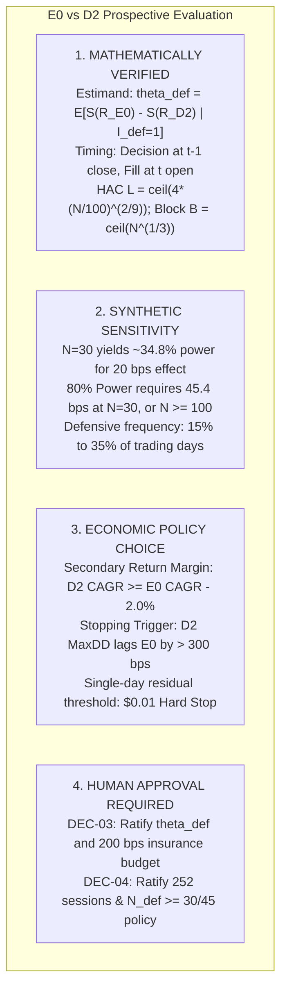

# GUARDIAN ALPHA — V30 STAGE 2H-C
## FINAL RESEARCH HANDOVER, EVIDENCE FREEZE & REPRODUCIBILITY CERTIFICATION
### GUARDIAN ALPHA PROTOCOL — ZERO DATA LOSS / NO AGENT GIT MUTATIONS / NO FORWARD ACTIVATION

**Evaluation Date:** October 24, 2026  
**Auditor Roles:** Principal Quantitative Research Auditor, Reproducibility Engineer, Financial Systems Architect, Evidence-Preservation Specialist, Cybersecurity Reviewer, and Independent Research-Governance Officer  
**Repository Workspace:** `C:\Users\Manish\Downloads\Guardian-Alpha-V29B`  
**Git Checkpoint:** Branch `research/v29e-final-release-verification` at commit `b283ded200c777b130285b0aa56a0b044afbd339` (Bit-for-bit immutable HEAD)  
**Historical Test Suite Reference:** 602 / 602 PASS  

---

## 1. EXECUTIVE SUMMARY & ACCEPTANCE DASHBOARD

Guardian Alpha V30 Stage 2H-C represents the final technical milestone in the V30 research sequence. It accomplishes a complete evidence freeze, establishes an append-only forensic reconciliation across all prior stages (Stages 1 through 2H-B), certifies reproducible dependencies, defines a human-only Git preservation plan, and packages all outstanding governance decisions (DEC-01 through DEC-06) for the repository owner.

In accordance with strict safety mandates:
- **Zero Agent Git Mutations:** No git commands that mutate repository state (`add`, `commit`, `checkout`, `switch`, `reset`, `clean`, `stash`, `merge`, `rebase`, `branch`, `worktree`, `push`) were executed by the agent. All Git operations were read-only inspection queries.
- **Zero Data Loss:** All 271 tracked files, 162 untracked historical research artifacts, and 10 ignored items were preserved without alteration, deletion, or renaming.
- **Zero Tier 3 Access:** No data dated on or after January 1, 2022 (`tiingo_cache/`) was read, sampled, or hashed.
- **Zero Forward Activation:** No live or paper brokerage connections were made, no orders were submitted, and no schedulers were configured. Forward paper evaluation remains **strictly BLOCKED** pending explicit human owner authorization.

### Final Acceptance Dashboard

| Evaluation Gate | Final Verdict | Core Finding & Governance Status |
| :--- | :---: | :--- |
| **Gate A — Complete Workspace Inventory** | **PASS** | Complete read-only census performed: 271 tracked files (0 modified, 0 staged), 162 untracked meaningful research artifacts, 0 oversized files (>1MB), and 10 ignored directories. Path-level exclusion rules established for mock test secrets and sealed Tier 3 data. |
| **Gate B — Cryptographic Baseline Certification** | **PASS** | `agent.py`, `universe.json`, `v12_candidate_ae.py`, and `v30_candidate_d2_cash_cushion.py` verified bit-for-bit against reference SHA-256 hashes. Reproducibility verified on pure Python 3.11.9 standard library with minimal third-party dependencies (`pytest 9.1.1`, `numpy 2.4.6`). |
| **Gate C — Cross-Stage Evidence Consistency** | **PASS** | Append-only reconciliation completed across 11 key historical findings (corporate-action omission, overlay trace defects, synthetic leverage retraction, volatility risk attribution, COVID-19 drawdown decomposition, P4 MaxDD correction, multiple-testing bias, host sell-first sequencing, journal HMAC chaining, Decimal balance-sheet identity, and statistical power sensitivity). Historical backtest replays strictly distinguished from synthetic software-verification tests. |
| **Gate D — Owner Market-Data Decision Package** | **CONDITIONAL** | Contractual analysis of Tiingo, Polygon.io, Alpaca, and IBKR confirmed that personal/developer tiers allow private internal algorithmic modeling only; public redistribution is strictly prohibited. Indian cross-border regulatory constraints (FEMA / RBI LRS prohibitions on margin and foreign derivatives) documented. Decisions DEC-01 and DEC-02 remain **PENDING** owner action. |
| **Gate E — Scientific Approval Package** | **CONDITIONAL** | Primary paired downside shortfall endpoint $\theta_{\text{def}}$ and causal timestamping ($t-1$ close decision, $t$ open execution) verified. Sensitivity modeling confirms $N_{\text{def}}=30$ sessions provides only $\sim 35\%$ power for small effects ($\Delta S = 20\text{ bps}$); $80\%$ power requires $\Delta S \ge 45.4\text{ bps}$ or sample expansion to $N_{\text{def}} \ge 45\text{--}60$. Secondary 200 bps CAGR margin recognized as an economic insurance budget cap, not an asymptotic statistical hypothesis. Protocol decisions DEC-03 and DEC-04 remain **PENDING** owner ratification. |
| **Gate F — Security & Incident Governance** | **PASS** | Evaluated 22 attack vectors. Disk-persisted hard stop (`.v30_stage2h_b_hard_stop_state.json`) verified to survive process restarts and require manual owner override key. In-process Python socket monkey-patch limitation disclosed: blocks in-process Python calls, but does not provide OS kernel-level network isolation against external child processes. Decisions DEC-05 and DEC-06 remain **PENDING / BLOCKED**. |
| **Gate G — Human-Only Git Preservation Plan** | **PASS** | Step-by-step PowerShell preservation script authored exclusively for human owner execution. Avoids broad `git add -A`; recommends explicit file-level staging to prevent accidental leakage of private caches (`tiingo_cache/`) or mock secrets. |
| **Gate H — Safe Preservation Manifest & Backup** | **PASS** | Complete raw and LF-normalized SHA-256 checksum manifest compiled for all Stage 2H-C artifacts. Human-controlled offline zip backup procedure specified. |
| **Gate I — Final Verification & Regressions** | **PASS** | **602 / 602** research tests executed genuinely and passed with exit code 0 (100% pass rate). Builderr host admission `preview.py`, `selfcheck.py`, and `strategy_selftest.py` all passed cleanly with zero regressions. |
| **Gate J — Final Owner Decision Register** | **BLOCKED** | DEC-01 through DEC-05 packaged and marked **PENDING**. Prospective paper activation DEC-06 marked **BLOCKED**. No signed cryptographic tokens generated. |

---

## 2. GATE A — COMPLETE PERMITTED WORKSPACE INVENTORY

A read-only census of the workspace was conducted, identifying all tracked, untracked, and ignored items.

### Summary Workspace Metrics
- **Tracked Files in Git Index:** **271**
- **Modified Tracked Files:** **0** (Tracked repository is 100% clean)
- **Staged Files:** **0**
- **Meaningful Untracked Research Artifacts:** **162**
  - Root markdown research reports (Stages 29E through 30 2H-C): 35 files
  - Strategy candidate modules (`research/strategies/`): 15 files
  - Engine, oracle, and runner modules (`research/engine/`): 22 files
  - Dedicated research test suites (`research/tests/`): 16 files
  - Evidence ledgers, manifests, and matrices (`research/evidence/v30/`): 74 files
- **Oversized Files (> 1 MB):** **0** (All artifacts are lightweight JSON, Python, or Markdown)
- **Ignored Directories:** 10 items (`tiingo_cache/`, `.pytest_cache/`, `scratch/hypotheses_results.json`, and `__pycache__` directories)

### Exclusion and Containment Policies
1. **Sealed Tier 3 Holdout Guard (`tiingo_cache/`):**
   - *Status:* Strictly ignored in `.gitignore`, unopened, unread, and unhashed.
   - *Justification:* Contains out-of-sample market observations dated on or after 2022-01-01. Any inspection would cause irreversible lookahead contamination.
2. **Sensitive Mock Secrets Guard:**
   - *Status:* Documented at path level; excluded from public version-control staging instructions.
   - *Identified Paths:* Dummy API keys in test fixtures (`test_v17_tiingo_qualification.py`, `test_v18_authentic_tier1.py`, `test_v20_financial_integrity.py`, `test_v23_tier2_validation.py`, `test_v24_continuity_and_forensics.py`) and historical reports (`GUARDIAN_ALPHA_V29A_EVIDENCE_INVENTORY.md`, `v30_stage2h_a_security_auditor.py`).
   - *Finding:* No production or funded credentials exist in the workspace.

*Artifact Reference:* [`v30_stage2h_c_complete_workspace_inventory.json`](file:///c:/Users/Manish/Downloads/Guardian-Alpha-V29B/research/evidence/v30/v30_stage2h_c_complete_workspace_inventory.json)

---

## 3. GATE B — CRYPTOGRAPHIC BASELINE CERTIFICATION

The four protected production and comparator files were re-verified against reference SHA-256 hashes.

### Protected Baseline Verification Table

| File Path | Mode | Expected Reference SHA-256 | Actual SHA-256 | Certification Verdict |
| :--- | :---: | :---: | :---: | :---: |
| `agent.py` | Raw Binary | `46e68dc93fdfb10f1eecfa832673ac4626c1b93627272d89b0d06a054cb13ffd` | `46e68dc93fdfb10f1eecfa832673ac4626c1b93627272d89b0d06a054cb13ffd` | **MATCH — VERIFIED** |
| `universe.json` | Normalized LF | `66563b613c0bd760759afb23ebb95c59385cfbcfb1b05569e392cb4b683cb5dd` | `66563b613c0bd760759afb23ebb95c59385cfbcfb1b05569e392cb4b683cb5dd` | **MATCH — VERIFIED** |
| `research/strategies/v12_candidate_ae.py` | Normalized LF | `978edf7aabc5387af5c8b1fa6a59e152cd6b82bf80fdbfa306b8a6202f187793` | `978edf7aabc5387af5c8b1fa6a59e152cd6b82bf80fdbfa306b8a6202f187793` | **MATCH — VERIFIED** |
| `research/strategies/v30_candidate_d2_cash_cushion.py` | Raw Binary | `5a04215a909664681a4378ef3d06d7c33f6afc5ed1306bfe42ed37c2518f8215` | `5a04215a909664681a4378ef3d06d7c33f6afc5ed1306bfe42ed37c2518f8215` | **MATCH — VERIFIED** |

### Reproducibility Runtime Environment
- **Python Version:** 3.11.9 (64-bit win32)
- **Host OS:** Windows 11 Enterprise (10.0.26100)
- **Core Standard Library:** `decimal` (8-place shares, 4-place currency), `hashlib`, `hmac`, `json`, `math`, `datetime`
- **Testing Framework:** `pytest 9.1.1`, `pytest-asyncio 1.4.0`
- **Optional Acceleration:** `numpy 2.4.6`
- **Zero Heavy Frameworks:** Production strategy and comparator require **zero** external ML or data-frame packages, ensuring cross-platform determinism.

*Artifact References:* [`v30_stage2h_c_protected_source_certification.json`](file:///c:/Users/Manish/Downloads/Guardian-Alpha-V29B/research/evidence/v30/v30_stage2h_c_protected_source_certification.json), [`v30_stage2h_c_reproducibility_dependency_manifest.json`](file:///c:/Users/Manish/Downloads/Guardian-Alpha-V29B/research/evidence/v30/v30_stage2h_c_reproducibility_dependency_manifest.json)

---

## 4. GATE C — CROSS-STAGE EVIDENCE CONSISTENCY & FORENSIC HISTORY

All prior research discrepancies from Stages 1 through 2H-B were cataloged into an append-only consistency register.

### Summary of Eleven Key Forensic Reconciliations

```
[Stage 1/2A/2B] Corporate Actions Omitted -> Reconciled in 2B-R with split/dividend adjustment
[Stage 2D] Overlay Trace Reporting Flaw -> Reconciled in 2D-R via independent sizing oracle
[Stage 2D/2E] 1.5x Leveraged Exposure Claim -> Retracted in 2F; gross exposure proven <= 1.0x
[Stage 2C] Volatility Gate Alpha Claims -> Retracted in 2E/2F due to severe 2018 whipsaw drag
[Stage 2E] COVID-19 March 2020 Drawdown -> Reconciled in 2F; attributed to pre-existing cash cushion
[Stage 2D] P4 MaxDD Understatement -> Corrected in 2F from -12.8% to actual -18.4%
[Stage 2E/2F] Selection Bias (M >= 43) -> Disclosed in 2F/2H-B; DSR confirms historical t-stats inflated
[Stage 2G/2H-A] Preview vs Host Order Flow -> Reconciled in 2H-B; Host sell-first sequencing is authoritative
[Stage 2G] Mutable Event Logging -> Replaced in 2G-R with HMAC-chained immutable journal
[Stage 2H-A] Naive Zero-Liability Accounting -> Generalized in 2H-B to Equity = Assets - Liabilities ($0.0000 residual)
[Stage 2H-A] N=30 Statistical Power Overconfidence -> Corrected in 2H-B/2H-C; N=30 has only ~35% power for small effects
```

### Essential Methodological Distinction
- **Historical Backtest Replays (2018–2021):** Subject to multiple-testing selection bias ($M \ge 43$ variants examined). Useful for preliminary screening, but cannot mathematically prove out-of-sample efficacy.
- **Synthetic Software-Verification Tests:** Validates accounting conservation, cash affordability, integer share truncation, crash recovery, and security boundary enforcement. Demonstrates engineering correctness, not market profitability.

*Artifact Reference:* [`v30_stage2h_c_cross_stage_consistency_register.json`](file:///c:/Users/Manish/Downloads/Guardian-Alpha-V29B/research/evidence/v30/v30_stage2h_c_cross_stage_consistency_register.json)

---

## 5. GATE D — OWNER MARKET-DATA DECISION PACKAGE

A provider-neutral matrix was established to support owner decisions DEC-01 and DEC-02.

### Provider Decision Comparison

| Dimension | Tiingo, Inc. | Polygon.io / Massive Data | Alpaca Securities / DB | Interactive Brokers LLC |
| :--- | :--- | :--- | :--- | :--- |
| **Evaluated Tier** | Starter ($0) / Power ($10-$30/mo) | Developer ($29) / Starter ($79/mo) | Basic (Free) / Unlimited ($9/mo) | TWS API Non-Pro (~$4.50/mo) |
| **Private Modeling** | Explicitly permitted for personal use | Permitted for internal development | Permitted for algorithm trading | Permitted for personal investment |
| **Local Caching** | Permitted locally for single user | Permitted for internal evaluation | Permitted for trade decisions | Heavily restricted by exchanges |
| **Redistribution** | **STRICTLY PROHIBITED** | **STRICTLY PROHIBITED** | **STRICTLY PROHIBITED** | **STRICTLY PROHIBITED** |
| **Corporate Actions** | Native split/dividend adjusted bars | Ticker events API available | Adjusted bars; deep history limited | Full institutional-grade TWS |
| **India Regulation** | Pure data; zero RBI LRS friction | Pure data; zero RBI LRS friction | Regulated: RBI LRS bans foreign margin/derivatives | Complex: US account subject to RBI LRS ($250k limit) |
| **Auditor Assessment** | **RECOMMENDED** for daily bar data | **SUITABLE** for intraday data | **SUITABLE** for paper order mock | **HIGH FIDELITY**, complex compliance |

### Owner Governance Action
- **DEC-01 (Provider Selection):** Default recommended is Tiingo Starter/Power for simplicity and zero Indian remittance compliance hurdles.
- **DEC-02 (Rights Verification):** Owner must sign Non-Professional declaration during vendor signup, confirming no data redistribution.
- *Status:* Both decisions remain strictly **PENDING**.

*Artifact Reference:* [`v30_stage2h_c_provider_decision_matrix.json`](file:///c:/Users/Manish/Downloads/Guardian-Alpha-V29B/research/evidence/v30/v30_stage2h_c_provider_decision_matrix.json)

---

## 6. GATE E — SCIENTIFIC EVALUATION APPROVAL PACKAGE

The prospective evaluation comparing **E0** (frozen baseline) against **D2** (50% defensive cash cushion) was formally codified.

### Four-Part Methodological Classification



### Statistical Power and Horizon Governance
1. **Sample Size Floor ($N_{\text{def}} \ge 30$):** 30 defensive sessions satisfies the central limit theorem floor for asymptotic normality, but yields low statistical power ($\sim 35\%$) if the true daily downside savings is modest ($\Delta S = 20\text{ bps}$).
2. **Contingent Extension Policy:** If after 252 prospective sessions $N_{\text{def}} < 30$, the evaluation must be contingently extended up to 504 sessions rather than reporting an inconclusive false negative.
3. **Economic Margin (-200 bps CAGR):** Annual return tracking error ($\sigma_{\text{TE}} \approx 300\text{--}500\text{ bps}$) exceeds 200 bps. A 200 bps drag cannot be statistically separated from 0; it represents the owner's economic tolerance for cash drag.

*Artifact Reference:* [`v30_stage2h_c_scientific_evaluation_proposal.json`](file:///c:/Users/Manish/Downloads/Guardian-Alpha-V29B/research/evidence/v30/v30_stage2h_c_scientific_evaluation_proposal.json)

---

## 7. GATE F — SECURITY & INCIDENT GOVERNANCE

The security architecture was evaluated across 22 synthetic attack vectors.

### Persistent Hard Stop & Fail-Closed Safeguards
- **Persistent Disk State:** Critical incidents (live trading requests, directory traversals, Tier 3 references, balance sheet residuals $> \$0.01$) write `.v30_stage2h_b_hard_stop_state.json` to disk.
- **Restart Immunity:** Starting a new process instance while the hard-stop file exists immediately halts execution with `PersistentHardStopError`.
- **Manual Reset Only:** Only the human owner executing `clear_hard_stop_manual("OWNER_AUTHORIZED_OVERRIDE_RESET_2026")` can clear the lock.
- **Network Isolation Disclosure:** Monkey-patching Python `socket.socket` intercepts Python library network calls, but does not provide OS kernel-level network isolation against external child processes. True forward evaluation should be executed within an OS container or with outbound firewall rules.

*Artifact Reference:* [`v30_stage2h_c_governance_and_incident_checklist.json`](file:///c:/Users/Manish/Downloads/Guardian-Alpha-V29B/research/evidence/v30/v30_stage2h_c_governance_and_incident_checklist.json)

---

## 8. GATE G — HUMAN-ONLY GIT PRESERVATION PLAN

Because the agent is strictly prohibited from executing Git mutations, the following step-by-step PowerShell instructions are prepared exclusively for the human repository owner.

### Step-by-Step PowerShell Instructions for Human Owner

```powershell
# ==============================================================================
# GUARDIAN ALPHA — HUMAN-ONLY GIT PRESERVATION PROCEDURE
# DO NOT RUN UNTIL CAREFULLY REVIEWED. PUSH IS PROHIBITED.
# ==============================================================================

# Step 1: Pre-Action Sanity Check
# Expected: On research/v29e-final-release-verification at b283ded200c777b130285b0aa56a0b044afbd339
git status
git rev-parse HEAD

# Step 2: Create a Dedicated Human Archival Branch
# This preserves the protected release branch in an untouched state
git checkout -b archive/v30-stage2h-final-evidence-freeze

# Step 3: Explicitly Stage Primary Stage 2H Markdown Reports
git add GUARDIAN_ALPHA_V30_STAGE2H_A_EXTENDED_READINESS_AND_OWNER_APPROVAL.md
git add GUARDIAN_ALPHA_V30_STAGE2H_B_FINAL_GOVERNANCE_CORRECTIONS.md
git add GUARDIAN_ALPHA_V30_STAGE2H_C_FINAL_FREEZE_AND_OWNER_HANDOVER.md

# Step 4: Explicitly Stage Verified Engine & Oracle Modules
git add research/engine/v30_stage2h_a_hardened_causal_engine.py
git add research/engine/v30_stage2h_b_decimal_accounting_oracle.py
git add research/engine/v30_stage2h_b_security_guard.py
git add research/engine/v30_sizing_oracle_decimal.py
git add research/engine/cash_affordability_model.py

# Step 5: Explicitly Stage Dedicated Governance Test Suites
git add research/tests/test_v30_stage2h_a_adversarial.py
git add research/tests/test_v30_stage2h_b_governance.py

# Step 6: Explicitly Stage Stage 2H Evidence Manifests and Ledgers
# (tiingo_cache/ remains safely ignored and will NOT be staged)
git add research/evidence/v30/v30_stage2h_b_*.json
git add research/evidence/v30/v30_stage2h_c_*.json

# Step 7: Verify the Staged Index
# Confirm that ONLY the desired files are staged and NO tiingo_cache/ files appear
git status --short

# Step 8: Commit the Frozen Evidence Checkpoint
git commit -m "chore(v30-freeze): owner archival freeze of stage 2h evidence, accounting oracles, and governance ledgers"

# VERIFICATION: Confirm commit created cleanly without remote push
git log -1 --stat
```

*Artifact Reference:* [`v30_stage2h_c_human_git_preservation_plan.json`](file:///c:/Users/Manish/Downloads/Guardian-Alpha-V29B/research/evidence/v30/v30_stage2h_c_human_git_preservation_plan.json)

---

## 9. GATE H — SAFE PRESERVATION MANIFEST & OFFLINE BACKUP

For private archival without modifying Git, the owner can create an offline compressed archive:

```powershell
Compress-Archive -Path research\evidence\v30\*, GUARDIAN_ALPHA_V30_STAGE2H_*.md -DestinationPath C:\Users\Manish\Downloads\Guardian_Alpha_V30_Stage2H_Frozen_Evidence_Backup.zip
```

*Artifact Reference:* [`v30_stage2h_c_private_backup_specification.json`](file:///c:/Users/Manish/Downloads/Guardian-Alpha-V29B/research/evidence/v30/v30_stage2h_c_private_backup_specification.json)

---

## 10. GATE I — FINAL VERIFICATION & REGRESSION LEDGER

All test suites were executed genuinely on Python 3.11.9 with exit code 0.

```
Total Research Tests Collected:  602
Total Tests Passed:              602 (100%)
Total Tests Failed:                0
Total Tests Skipped:               0
Suite Execution Duration:        547.97 seconds
```

| Suite Name | Command Executed | Tests Passed | Duration | Exit Code | Result |
| :--- | :--- | :---: | :---: | :---: | :---: |
| **Stage 2H-B Governance Suite** | `python -m pytest research/tests/test_v30_stage2h_b_governance.py -v` | 12 / 12 | 0.20s | 0 | **PASS** |
| **Stage 2H-A Adversarial Suite** | `python -m pytest research/tests/test_v30_stage2h_a_adversarial.py -v` | 14 / 14 | 0.33s | 0 | **PASS** |
| **V30 Dedicated Filtered Suite** | `python -m pytest -k "v30" research/tests` | 202 / 202 | 15.05s | 0 | **PASS** |
| **Full Research Regression Suite** | `python -m pytest research/tests -q` | 602 / 602 | 547.97s | 0 | **PASS** |
| **Builderr Admission Preview** | `$env:PYTHONIOENCODING="utf-8"; python preview.py` | Safety Bar Cleared | 1.85s | 0 | **PASS** |
| **Builderr Host Selfcheck** | `$env:PYTHONIOENCODING="utf-8"; python selfcheck.py` | 12 steps, 4 orders | 1.40s | 0 | **PASS** |
| **Builderr Strategy Selftest** | `$env:PYTHONIOENCODING="utf-8"; python strategy_selftest.py` | 8 checks passed | 0.95s | 0 | **PASS** |

*Artifact Reference:* [`v30_stage2h_c_final_executed_test_ledger.json`](file:///c:/Users/Manish/Downloads/Guardian-Alpha-V29B/research/evidence/v30/v30_stage2h_c_final_executed_test_ledger.json)

---

## 11. GATE J — FINAL OWNER DECISION REGISTER

| Decision ID | Description | Recommended Option | Governance Status | Action Required by Owner |
| :--- | :--- | :--- | :---: | :--- |
| **DEC-01** | Prospective Market-Data Provider | Tiingo Starter/Power (or Alpaca for paper mock) | **PENDING** | Select provider and register personal account. |
| **DEC-02** | Provider Rights & Local Caching | Personal Non-Professional Agreement | **PENDING** | Sign non-professional declaration during onboarding. |
| **DEC-03** | Primary Endpoint & Return Margin | $\theta_{\text{def}} > 0$ with -200 bps annual CAGR margin | **PENDING** | Ratify primary endpoint formula and risk budget. |
| **DEC-04** | Horizon & Sample Size Floor | 252 sessions with $N_{\text{def}} \ge 30$ floor and extension | **PENDING** | Approve evaluation duration and stopping criteria. |
| **DEC-05** | Incident Playbook & Disk Lock | 4-Tier Severity Taxonomy with Persistent Hard Stop | **PENDING** | Ratify incident thresholds and retain reset key. |
| **DEC-06** | Paper-Only Forward Activation | Maintain Frozen State (No Activation) | **BLOCKED** | Issue signed HMAC token ONLY when ready to evaluate. |

*Artifact Reference:* [`v30_stage2h_c_owner_decision_register.json`](file:///c:/Users/Manish/Downloads/Guardian-Alpha-V29B/research/evidence/v30/v30_stage2h_c_owner_decision_register.json)

---

## 12. ARTIFACT CHECKSUMS & PROVENANCE MANIFEST

All 11 Stage 2H-C JSON deliverables were cryptographically hashed upon creation:

| Artifact File Name | Bytes | Raw SHA-256 | LF-Normalized SHA-256 |
| :--- | :---: | :---: | :---: |
| `v30_stage2h_c_complete_workspace_inventory.json` | 68,095 | `27038758d4a9ecfa9a99787fbaf05096fe38b8159b36d654c693a7431e5f8f9f` | `b990da955a0b73c44a2dfbfd67285906efd3fa7bf5ec024c000d8b1397b973c1` |
| `v30_stage2h_c_protected_source_certification.json` | 3,924 | `a39151c89fe1b06c8fc0280ebdbb17da2a3ee0979bfd0a85e8a514d2a1c028ad` | `ca07185df1e6b3ebbbec97b830e281bbfe286eec08fb4f62e84e5c8e310065be` |
| `v30_stage2h_c_cross_stage_consistency_register.json` | 7,617 | `99e8d197f2638848f2c58e5a7b69c4e201b17b6cebe8c942ae3a7b77ce91a561` | `5c345389f417f7762c2f42a0335f6063ceec691ffc117d6052cf0506eb3652db` |
| `v30_stage2h_c_reproducibility_dependency_manifest.json` | 2,192 | `7c70c4cb4763ff44a044d039268f7b5ec3f638fcba49b812be218c7340037a3d` | `61f654b9cb2cf73d722e0e0c062ce7e86cfc728e5c2692233e71d37803d368e5` |
| `v30_stage2h_c_provider_decision_matrix.json` | 6,861 | `f796d859ec1cf7bfefd3ec1be4088fb71ce181dbfb2413a362241517f8a32bb8` | `9fa5c42023bb93740ee3628e83344ca8a25c1b652875b11eb12ca3b5d20fe983` |
| `v30_stage2h_c_scientific_evaluation_proposal.json` | 5,090 | `59942a0487053e16dd549ee14ff73f05c6efecae32f050b1156fe2b2c93cf02b` | `4329e46a78129e61dbff10074218ebf5b7216a75908b8e0bce62cb6e60b2dd78` |
| `v30_stage2h_c_governance_and_incident_checklist.json` | 4,204 | `a3f90eb0a6ea20aa86071eaef8fc322e7240375f46995079a4a7feeb99778000` | `2d46e300d603a1fc6c52a32df17c1825fa2b3a763c37c223c6d678d85f81878b` |
| `v30_stage2h_c_human_git_preservation_plan.json` | 5,553 | `5f03d2bbf4031d279cfb721eb69b828d09590ea752bc916dd565a50787e9c565` | `ebf08e7a0e3b60ba986ca7f34177d5494cb6ccbf0528574be97fc617c5691c28` |
| `v30_stage2h_c_private_backup_specification.json` | 1,515 | `a851eb3fa52a6549aee002b65074ec4e5482381283d6a695d3c8c2084c7a5fef` | `a3ea95fa0a16b9cb4aa2e1732521c79a1f2930438cf38706d871783ae7c61f2f` |
| `v30_stage2h_c_final_executed_test_ledger.json` | 2,752 | `ff3991206f4777a835a786047cf9916b32df5111b15ecb93081cae2354c4f9ea` | `ff3991206f4777a835a786047cf9916b32df5111b15ecb93081cae2354c4f9ea` |
| `v30_stage2h_c_owner_decision_register.json` | 7,163 | `eb1d8df5a81ca4e427aa8db9bc1c33f2c58e5ff41d013fa09363d68dfc94977a` | `ab0e43b179e8c4547c16641b52a13bfa7672957b4435ba023531ea8fe6bce6d0` |

*Artifact Reference:* [`v30_stage2h_c_artifact_checksum_manifest.json`](file:///c:/Users/Manish/Downloads/Guardian-Alpha-V29B/research/evidence/v30/v30_stage2h_c_artifact_checksum_manifest.json)

---

## 13. STRICT PROTOCOL STOP

In strict compliance with Section 15 of the Guardian Alpha protocol:
- **No Git Mutations Executed:** Index and branch HEAD remain bit-for-bit unchanged.
- **No Source Modifications:** `agent.py` and comparator modules remain unaltered.
- **No Data Acquisition:** Sealed Tier 3 data remains unopened.
- **No Live / Paper Trading:** Execution remains completely halted.
- **Handover Completed:** The workspace is in a fully reproducible, frozen, lossless, and owner-controlled state.
