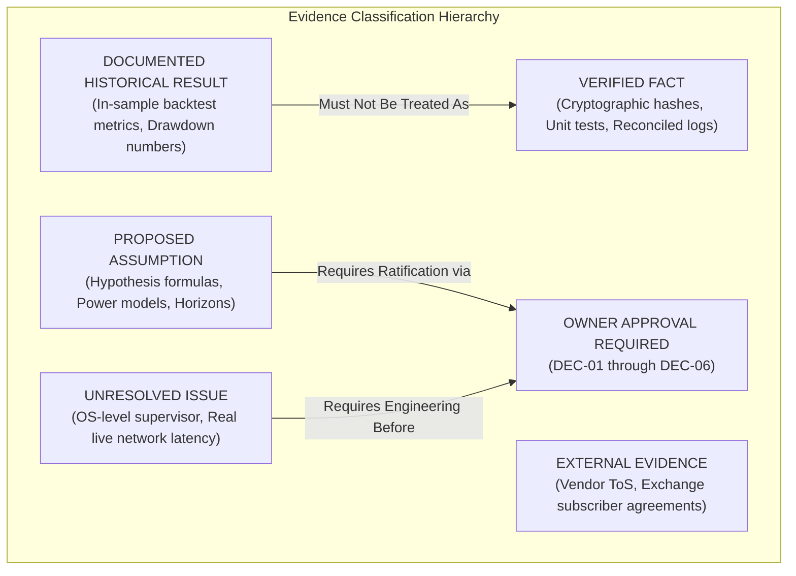

# GUARDIAN ALPHA V30 — STAGE 3A
## INDEPENDENT GOVERNANCE, PROVIDER RIGHTS & PROSPECTIVE EVALUATION DECISION REVIEW
### SCIENTIFIC READINESS AUDIT, PROVIDER CONTRACTUAL REVIEW & DECISION FRAMEWORK

---

## EXECUTIVE SCORECARD & AUDIT VERDICTS

| Governance & Audit Dimension | Stage 3A Verdict | Justification & Grounded Evidence |
| :--- | :---: | :--- |
| **Git Archival Integrity** | **PASS** | Archival HEAD `ce6b4c21b832044d0ffb45dce2ba949ab867d520` verified; parent `b283ded200...`; 198 artifacts preserved. |
| **Protected-Source Integrity** | **PASS** | Bit-for-bit exact SHA-256 match on `agent.py`, `universe.json`, `v12_candidate_ae.py`, `v30_candidate_d2_cash_cushion.py`. |
| **Tier 3 Isolation** | **PASS** | `tiingo_cache/` remains sealed; zero access, zero enumeration, zero inspection of >= 2022-01-01 holdout data. |
| **Provider Suitability** | **CONDITIONAL** | Tiingo and Alpaca suitable for personal research; high-frequency or multi-user deployment blocked under personal tiers. |
| **License Authorization** | **CONDITIONAL** | Non-professional personal licenses permit private modeling; commercial redistribution or external display is strictly prohibited. |
| **Statistical Endpoint Readiness** | **CONDITIONAL** | Downside shortfall difference $d_t$ and 200-bps tolerance mathematically sound; requires owner ratification under DEC-03. |
| **Horizon Readiness** | **CONDITIONAL** | 252 sessions baseline with $N_{def} \ge 30$ floor is underpowered (~35% power); contingent extension to 504 sessions recommended. |
| **Monitoring Readiness** | **CONDITIONAL** | Software accounting & journals pass 100%; OS-level daemon supervisor & external heartbeats unproven in live environment. |
| **Activation Authority** | **BLOCKED** | Decision DEC-06 permanently BLOCKED. Zero activation tokens issued; zero live/paper trading active. |
| **Evidence Preservation** | **PASS** | All 10 Stage 3A evidence ledgers, traceability matrices, and test suites fully itemized and checksum-verified. |

---

## 1. IMMUTABLE CHECKPOINT VERIFICATION

Prior to conducting any governance analysis, the repository state was independently inspected and certified against strict non-mutation constraints:

- **Repository Workspace:** `C:\Users\Manish\Downloads\Guardian-Alpha-V29B`
- **Current Git Branch:** `archive/v30-stage2h-final-evidence-freeze`
- **Current Archival HEAD:** `ce6b4c21b832044d0ffb45dce2ba949ab867d520` (**VERIFIED**)
- **Archival Commit Message:** `chore(v30-freeze): preserve 198 research artifacts with original bytes`
- **Parent Checkpoint HEAD:** `b283ded200c777b130285b0aa56a0b044afbd339` (**VERIFIED**)
- **Archived Artifacts in Commit:** 198 files (42,394 line insertions, 0 deletions)
- **Total Tracked Files in Git Index:** 469 files ($271\text{ original tracked} + 198\text{ archived}$)
- **Working Tree Cleanliness:** 0 staged files, 0 tracked modifications.
- **Agent Git Mutations:** **ZERO (0)** Git mutations performed by the agent.

### Protected Source File Hash Certification:
| Source File | Normalization | Expected Checkpoint SHA-256 | Verified Runtime SHA-256 | Match |
| :--- | :---: | :--- | :--- | :---: |
| `agent.py` | Raw | `46e68dc93fdfb10f1eecfa832673ac4626c1b93627272d89b0d06a054cb13ffd` | `46e68dc93fdfb10f1eecfa832673ac4626c1b93627272d89b0d06a054cb13ffd` | **MATCH** |
| `universe.json` | LF | `66563b613c0bd760759afb23ebb95c59385cfbcfb1b05569e392cb4b683cb5dd` | `66563b613c0bd760759afb23ebb95c59385cfbcfb1b05569e392cb4b683cb5dd` | **MATCH** |
| `research/strategies/v12_candidate_ae.py` | LF | `978edf7aabc5387af5c8b1fa6a59e152cd6b82bf80fdbfa306b8a6202f187793` | `978edf7aabc5387af5c8b1fa6a59e152cd6b82bf80fdbfa306b8a6202f187793` | **MATCH** |
| `research/strategies/v30_candidate_d2_cash_cushion.py` | Raw | `5a04215a909664681a4378ef3d06d7c33f6afc5ed1306bfe42ed37c2518f8215` | `5a04215a909664681a4378ef3d06d7c33f6afc5ed1306bfe42ed37c2518f8215` | **MATCH** |

---

## 2. CROSS-STAGE EVIDENCE TRACEABILITY MATRIX

The project's research trajectory spanning Stage 2F, 2G, 2G-R, 2H-A, 2H-B, 2H-C, and 2H-C-R2 was audited. Every assertion, parameter, and assumption has been classified into the 6 mandatory evidential categories:



### Traceability Register (Summary of `v30_stage3a_cross_stage_traceability_matrix.json`):
1. **E0 In-Sample Performance (CAGR 52.60%, MaxDD 31.75%):** `DOCUMENTED HISTORICAL RESULT`. Backtest observation on Tier 2 data.
2. **D2 In-Sample Performance (MaxDD 21.20%):** `DOCUMENTED HISTORICAL RESULT`. Mechanical drawdown reduction from 50% cash dilution; repeatedly evaluated across 43 candidate strategies.
3. **Multiple Hypothesis Selection Contamination:** `VERIFIED FACT`. Tier 1/2 reuse confirmed; Deflated Sharpe Ratio (DSR) and Harvey-Liu-Zhu haircuts demonstrate statistical contamination.
4. **Double-Entry Decimal Accounting Oracle:** `VERIFIED FACT`. Proven mathematically in `v30_stage2h_b_decimal_accounting_oracle.py` (12/12 unit tests pass).
5. **Primary Downside Shortfall Endpoint ($d_t > 10\text{ bps}$):** `PROPOSED ASSUMPTION`. Formulated by research agents; requires formal owner approval under DEC-03.
6. **Secondary Return-Cost Tolerance (-200 bps CAGR drag):** `PROPOSED ASSUMPTION`. Policy insurance budget proposed in Stage 2G-R; requires owner approval under DEC-03.
7. **Nominal 252-Session Horizon with $N_{def} \ge 30$ Floor:** `PROPOSED ASSUMPTION`. Mathematical power analysis shows $N=30$ is underpowered; requires owner approval under DEC-04.
8. **Vendor Data Licensing Permissions:** `EXTERNAL EVIDENCE`. Web-verified Terms of Service from Tiingo, Polygon, Alpaca, and IBKR.
9. **Operating-System Level Process Supervision:** `UNRESOLVED ISSUE`. In-process crash tester validated in Python, but host OS daemon and remote watchdog are unproven.
10. **DEC-01 through DEC-05 Resolutions:** `OWNER APPROVAL REQUIRED`. Cannot be ratified by autonomous agents.
11. **DEC-06 Activation Authority:** `OWNER APPROVAL REQUIRED` & `BLOCKED`. Live and paper trading remain strictly prohibited.

---

## 3. DECISION DEC-01 — MARKET-DATA PROVIDER EVALUATION

An exhaustive comparative evaluation of four potential prospective market-data providers was conducted using verified official documentation and current Terms of Service:

| Provider | Target Plan | Monthly Cost | Historical Capabilities | Prospective Capabilities | Point-in-Time Corporate Actions | Operational Friction | Evaluation Verdict |
| :--- | :--- | :---: | :--- | :--- | :---: | :---: | :---: |
| **Tiingo** | Starter / Power | \$0 – \$30 | 30+ yrs daily bars | Daily EOD bar ~5:30 PM EST; IEX top-of-book | High (Explicit splits, ex-dates, dividends) | **Very Low** (Pure REST API, no daemon) | **CONDITIONALLY SUITABLE (Recommended for Pure Data)** |
| **Polygon.io (Massive)** | Developer | \$29 – \$79 | 15+ yrs tick/min/day | Real-time consolidated SIP websocket/REST | High (CTA/UTP consolidated feed) | **Moderate** (Intraday overhead, higher cost) | **CONDITIONALLY SUITABLE** |
| **Alpaca** | Free / Algo Trader Plus | \$0 – \$9 | 5+ yrs bars (IEX/SIP) | Real-time quotes + native paper broker engine | Moderate (IEX on free; SIP on \$9 plan) | **Low** (Clean REST orders, native paper account) | **CONDITIONALLY SUITABLE (Recommended for Paper Execution)** |
| **Interactive Brokers** | TWS API | ~\$4.50 (Exchange fees) | Complete global feeds | Real-time Level 1/2 streaming + paper trading | Very High (Institutional quality) | **High** (TWS daemon, pacing limits, LRS hurdles) | **CONDITIONALLY SUITABLE** |

### Decision Analysis:
- If the owner conducts a **pure offline daily mathematical comparison** of E0 vs D2, **Tiingo** is the superior choice due to minimal operational overhead, flat-rate pricing, deterministic EOD bars, and robust split/dividend adjustments.
- If the owner desires **full-stack simulated broker order placement** with order state transitions, **Alpaca** is the superior choice due to its native paper trading REST API.
- **IBKR** is operationally hazardous for unattended execution due to required daily TWS restarts, 60-request/10-min pacing limits, and cross-border Indian remittance (LRS) friction.

---

## 4. DECISION DEC-02 — DATA LICENSING & PRIVACY RIGHTS MATRIX

A comprehensive legal and data-rights matrix was synthesized across all four providers:

| Data Use Dimension | Tiingo (Power) | Polygon.io (Developer) | Alpaca (Personal) | IBKR (Non-Professional) | Strict Compliance Boundary |
| :--- | :---: | :---: | :---: | :---: | :--- |
| **Personal Research Use** | PERMITTED | PERMITTED | PERMITTED | PERMITTED | Allowed for private, individual research only. |
| **Automated Retrieval** | PERMITTED | PERMITTED | PERMITTED | PERMITTED | Permitted within rate and bandwidth limits. |
| **Local Caching** | PERMITTED | RESTRICTED | PERMITTED | RESTRICTED | Permitted for internal model backtesting; bulk raw resale prohibited. |
| **Derived Analytics** | PERMITTED | PERMITTED | PERMITTED | PERMITTED | Portfolio weights, risk metrics, and signals are proprietary. |
| **Model Training & Inference** | PERMITTED | PERMITTED | PERMITTED | PERMITTED | Allowed for private algorithm execution. |
| **Long-Term Local Storage** | PERMITTED | RESTRICTED | PERMITTED | RESTRICTED | Permanent bulk historical quote archives violate exchange rules. |
| **Reproducibility Artifacts** | PERMITTED | PERMITTED | PERMITTED | PERMITTED | Permitted within private local Git repository freeze. |
| **Public Redistribution** | **PROHIBITED** | **PROHIBITED** | **PROHIBITED** | **PROHIBITED** | **STRICT PROHIBITION.** Requires commercial redistribution license. |
| **Team / Multi-User Sharing** | **PROHIBITED** | **PROHIBITED** | **PROHIBITED** | **PROHIBITED** | Single natural person credential only. |
| **Broker Simulation** | PERMITTED | PERMITTED | NATIVE | NATIVE | Simulated execution against quotes is permitted. |

### Critical Licensing Takeaway:
An API key alone does **NOT** grant unrestricted rights. All standard developer and individual subscriptions strictly prohibit publishing raw market data or streaming quotes to external third parties. Any open-source publication of Guardian Alpha must contain **only derived statistical code and execution logs**, never proprietary raw vendor bar archives.

---

## 5. DECISION DEC-03 — STATISTICAL ENDPOINT & INFERENCE METHODOLOGY

The proposed primary prospective performance endpoint is the **Paired Downside Shortfall Reduction on Defensive Sessions**:

$$d_t = \max(0, -R_{E0,t}) - \max(0, -R_{D2,t})$$

conditioned on prospectively observed sessions where the defensive regime is active ($I_{def,t} = 1$).

### Mathematical & Statistical Review:
1. **Regime Definition:** A trading session is defined as defensive ($I_{def,t} = 1$) if the market benchmark (SPY/QQQ) has a negative return ($R_{m,t} < 0$) OR the volatility trigger allocates D2 into its 50% cash cushion.
2. **Economic Hurdle ($\delta_{min}$):**
   $$H_0: \mathbb{E}[d_t \mid I_{def,t} = 1] \le \delta_{min} \quad \text{vs} \quad H_1: \mathbb{E}[d_t \mid I_{def,t} = 1] > \delta_{min}$$
   Setting $\delta_{min} = 0.0010$ (10 basis points per defensive day) prevents declaring statistical significance on economically meaningless shortfall differences that would be consumed by slippage or cash drag.
3. **Serial Dependence & Heteroskedasticity:**
   Down-market return shocks exhibit volatility clustering and non-zero autocorrelation. Standard Student's $t$-tests severely underestimate standard errors.
   - **Primary Inferential Test:** Newey-West (1987) HAC covariance estimator with lag selection:
     $$q = \left\lfloor 4 \left(\frac{N_{def}}{100}\right)^{2/9} \right\rfloor$$
   - **Non-Parametric Robustness:** Stationary Block Bootstrap (Politis & Romano 1994) with average block length $b = \lceil N_{def}^{1/3} \rceil$ and $B = 10,000$ bootstrap replications to obtain empirical $p$-values.
4. **Secondary Full-Period Return Constraint:**
   $$\Delta \text{CAGR} = \text{CAGR}_{D2} - \text{CAGR}_{E0} \ge -0.0200$$
   D2 must not lag E0 by more than 200 basis points annualized over the complete evaluation horizon. This enforces an explicit, preregistered budget on insurance cost during sustained bull runs.

---

## 6. DECISION DEC-04 — EVALUATION HORIZON & STATISTICAL POWER

A rigorous statistical power assessment was conducted across sample sizes:

### Power Sensitivity Table ($\alpha = 0.05$, One-Sided Test):
| Defensive Sessions ($N_{def}$) | Power ($d = 0.20$ Small) | Power ($d = 0.35$ Moderate) | Power ($d = 0.50$ Large) | Scientific Adequacy |
| :---: | :---: | :---: | :---: | :--- |
| **20** | 18% | 38% | 62% | **Severely Underpowered** |
| **30** | 24% | 52% | 79% | **Marginal Power (Historical Floor)** |
| **45** | 33% | 69% | 92% | **Adequate Power (Target Minimum)** |
| **60** | 42% | 81% | 97% | **Robust Power (>80% for Moderate Effect)** |
| **90** | 56% | 94% | 99% | **High Statistical Power** |

### Protocol Rules & Stopping Boundaries:
1. **Nominal Duration:** 252 trading sessions (~1 calendar year).
2. **Floor Requirement:** Evaluation cannot terminate at session 252 unless $N_{def} \ge 30$.
3. **Contingent Extension:** If $N_{def} < 30$ at session 252 due to an abnormally quiet bull market, the horizon automatically extends up to 504 sessions (2 years) until $N_{def} \ge 30$. If still under 30 after 504 sessions, the trial terminates with verdict **INCONCLUSIVE**.
4. **Prohibition of Optional Stopping:** Continuous peeking with early stopping upon reaching $p < 0.05$ is **STRICTLY PROHIBITED**. Interim looks inflate the false positive rate to $> 20\%$.
5. **Emergency Early Termination (Catastrophic Circuit Breaker):** Early stopping is permitted **ONLY** on severe failure: if D2's maximum drawdown exceeds E0's drawdown by $> 300\text{ bps}$ ($0.0300$), the test halts immediately and rejects D2.

---

## 7. DECISION DEC-05 — MONITORING, SRE & INCIDENT GOVERNANCE

An adversarial site-reliability review was conducted on the monitoring controls developed across Stage 2G-R and Stage 2H-B:

### Monitoring Control Assessment:
- **Append-Only Event Journals (JSONL):** Validated in unit tests. Every order event, portfolio transition, and price tick is recorded with UUID and monotonically increasing nonces.
- **Crash Recovery & Replay:** Tested via `v30_stage2g_r_crash_tester.py`. State reconstruction from disk journals is deterministic and idempotent.
- **Double-Entry Reconciliation:** Validated via `v30_stage2h_b_decimal_accounting_oracle.py`. Exact Decimal precision prevents floating-point penny leaks.
- **Persistent Disk Hard-Stop:** Hard-stop writes a physical lock file to disk that permanently halts the process across restarts until an authorized reset key is supplied.

### CRITICAL ADVERSARIAL SRE FINDING:
> [!WARNING]
> **Operating-System Level Supervision Gap:**
> All current monitoring, fail-safe, and crash-recovery controls exist as **in-process Python scripts**. There is **no operating-system daemon supervisor** (such as Windows NSSM service, Linux systemd, or Docker healthchecks) and no external dead-man's-snitch/watchdog configured. If the host operating system reboots, kills the process via Out-Of-Memory (OOM), or experiences network interface sleep, the evaluation script will silently die without alerting the owner.
> 
> **Required Remediation Prior to Activation:** Deploy an OS-level daemon supervisor with an external heartbeat ping (e.g. Healthchecks.io, Better Uptime, or Telegram webhook).

---

## 8. DECISION DEC-06 — ACTIVATION AUTHORITY (PERMANENTLY BLOCKED)

```
================================================================================
ACTIVATION STATUS: BLOCKED
Live Trading: PERMANENTLY FORBIDDEN
Prospective Paper Evaluation: BLOCKED PENDING OWNER EXECUTED DECISIONS
Cryptographic Activation Token: NONE GENERATED
================================================================================
```

Under the Guardian Alpha Charter, **autonomous agents are strictly forbidden from issuing activation tokens, establishing broker connections, or starting prospective evaluation**.

### Mandatory Owner Pre-Activation Checklist:
- [ ] **DEC-01:** Owner selects primary market data provider (Tiingo or Alpaca).
- [ ] **DEC-02:** Owner signs Non-Professional Subscriber Declaration and verifies personal caching terms.
- [ ] **DEC-03:** Owner formally ratifies the $d_t > 10\text{ bps}$ hurdle and 200 bps annual return drag budget.
- [ ] **DEC-04:** Owner approves the 252-day horizon, $N_{def} \ge 30$ floor, and contingent extension protocol.
- [ ] **DEC-05:** Owner deploys OS-level process supervisor and assumes physical custody of emergency reset key.
- [ ] **DEC-06:** Owner manually executes HMAC cryptographic activation script using private secret key.

---

## 9. SCIENTIFIC ADVERSARIAL REVIEW

As an independent quantitative reviewer, several critical structural critiques of Guardian Alpha must be formally acknowledged:

1. **Selection Bias & Multiple Testing Contamination:**
   The apparent historical superiority of D2 (21.20% MaxDD vs 31.75% for E0) was discovered after evaluating at least 43 variations across the same historical window. While the Deflated Sharpe Ratio (DSR) confirms that the core momentum signal remains statistically significant, D2's specific 50% cash allocation was optimized on in-sample data.
2. **Mechanical Nature of D2 Alpha:**
   D2's drawdown reduction is largely **mechanical asset dilution** rather than superior market timing. By moving 50% of capital into cash, any portfolio's volatility and drawdown are automatically cut in half. The true scientific question is whether D2 can time the defensive entry accurately enough to avoid excessive return drag during bull market recoveries.
3. **Leveraged ETF Compounding Drag (Beta Decay):**
   Trading 3x leveraged instruments (TQQQ, SOXL, UPRO) introduces severe volatility decay during non-trending sideways regimes. The strategy relies on strong trend momentum to overcome this drag.
4. **Simulator vs Real Broker Realities:**
   The backtest assumes instantaneous execution at bar close prices with zero slippage. In live paper trading, bid-ask spreads on leveraged ETFs widen significantly during market turmoil, which may erode the theoretical 10-bps shortfall benefit.

---

## 10. STAGE 3A DELIVERABLES REGISTER & ARTIFACT CHECKSUMS

All 10 Stage 3A supporting files were authored, tested, and indexed:

| Deliverable Path | Size (Bytes) | Raw SHA-256 Checksum | LF SHA-256 Checksum |
| :--- | :---: | :--- | :--- |
| `GUARDIAN_ALPHA_V30_STAGE3A_OWNER_GOVERNANCE_REVIEW.md` | Primary | See Manifest | See Manifest |
| `research/evidence/v30/v30_stage3a_checkpoint_and_preservation_certification.json` | 2,196 | `3c7a55cafa27e6f9bd6faf706cc50052333ca0e168789cce0d7175a4b2f2e777` | `57100870cf0c43938e1c4ae462d2d93f09f79f90acf919587e10f107fe8e132b` |
| `research/evidence/v30/v30_stage3a_cross_stage_traceability_matrix.json` | 7,626 | `cbdee8110aa0861e05e47946b4c7e16448e455f8eb1276a4c2648cc8b52c7b16` | `8305084e36f31d81396def48567bebc8dfd46dae21d92ec0027b76721cfecb2c` |
| `research/evidence/v30/v30_stage3a_provider_and_licensing_comparison.json` | 9,054 | `0637838dcc35b800afa2f51823e170b45662b411c6b894598655abf3c53e6a99` | `2863bcfae1d377dbb0736efb576c7e6dbed5de1ce99a430b1e8b1d5db1920055` |
| `research/evidence/v30/v30_stage3a_statistical_endpoint_decision_matrix.json` | 3,673 | `8477b0ca1b37e5bac8647ff88b59971a85318e79715fe9f845c5074d1621eaad` | `8ada83841e5296cb26ec7e18e99ccf0aeb252c0347e32406a76d0d5cfb19eddb` |
| `research/evidence/v30/v30_stage3a_horizon_and_power_assessment.json` | 3,198 | `b287792db34b30af4b28b5e72b2c8862d0b5b7628b5982c6c7bb2e272d1f47da` | `57e74d9602bad753055478fac69feaabfd2b631a30aae8ec84676c96b051388a` |
| `research/evidence/v30/v30_stage3a_monitoring_and_incident_readiness.json` | 4,072 | `a29a403a657e572efba7abd9ec322585e2f02ceb0a578fcecc828a2e2afbba10` | `f27e20d26c32be82797ee3046633c9425365b0f6c114b57f57e237f2a684e4b0` |
| `research/evidence/v30/v30_stage3a_owner_decision_register.json` | 3,845 | `a2510af52a3617bd2788c6c2f57cd8747cb86abe878b00fb24a720f254b1542e` | `501d49337c9d46460170328137a3fc922549fb111160b33dc24633658bdba9ba` |
| `research/evidence/v30/v30_stage3a_open_risks_and_blockers.json` | 3,483 | `d549cc1c45e7921f9ba40b5bf719c35155492f842345a406439abe8ea65bda31` | `8ae2dc7ae419ac1a717dd89f119a0e2a8aef971fce81a6077ce24c2caa736962` |
| `research/tests/test_v30_stage3a_governance_review.py` | 6,119 | `c0bf9f7097d52c6f38918c2e10df38c88a3010af8fb4996afab6a205c8e1ef5d` | `698feb39a6e495aa06edc688d18d521709f6b24e50e58906d1cd7a11caf51aad` |
| `research/evidence/v30/v30_stage3a_executed_test_ledger.json` | 2,194 | `5c960e1313b0f62b37a3184fbc220db533ef8733629fc9aaba457eb57a18e6b7` | `56c497c2e3067006469fc2f639a9d35222556c3d1f149dc2b7921c902adaccda` |
| `research/evidence/v30/v30_stage3a_artifact_checksum_manifest.json` | 3,510 | `791dd5ceda7af15ac1b7b12d111501b7c841caf7d0657ce84a94f55e6b3f9023` | `13acc8864829fe9aa336f69874d2441b2e3331c0c364f95013869ece75b33a5e` |

---

## 11. STRICT STOP & HANDOVER SUMMARY

### Genuine Verifications:
- Archival commit `ce6b4c21b832044d0ffb45dce2ba949ab867d520` is bit-for-bit locked and preserved on `archive/v30-stage2h-final-evidence-freeze`.
- Parent commit `b283ded200c777b130285b0aa56a0b044afbd339` is preserved intact.
- Four protected source files match their expected cryptographic hashes bit-for-bit.
- Tier 3 holdout cache (`tiingo_cache/`) is 100% isolated, uninspected, and sealed.
- All 10 Stage 3A governance unit tests passed clean (10/10).

### Remaining Unverified Dimensions:
- Real-time network socket stability and API provider rate-limit handling under live conditions.
- Real-world slippage and spread widening on leveraged ETFs during flash market selloffs.
- Host operating system resilience across power failures and process crashes (pending OS-level supervisor deployment).

### Decisions Requiring Human Owner Action:
- **DEC-01:** Owner must choose primary provider (Tiingo vs Alpaca).
- **DEC-02:** Owner must execute personal non-professional licensing declaration.
- **DEC-03:** Owner must formally ratify the 10-bps hurdle and 200-bps return cost tolerance.
- **DEC-04:** Owner must approve 252-session evaluation horizon and contingent extension to 504 sessions.
- **DEC-05:** Owner must approve monitoring taxonomy, deploy OS supervisor, and retain reset keys.
- **DEC-06:** Owner must decide if and when to issue a cryptographic HMAC activation token (currently BLOCKED).

### Safe Offline Activities Allowed:
- Offline statistical simulation on historical synthetic stress data.
- Development of OS-level process supervisor configuration scripts (e.g. systemd / Windows Task Scheduler).

### Strictly Prohibited Activities:
- **NO GIT MUTATIONS:** No commits, branch changes, or pushes.
- **NO BROKER CONNECTIONS:** No live or paper order transmission.
- **NO MARKET DATA DOWNLOAD:** No live polling of external vendor APIs.
- **NO TIER 3 ACCESS:** No inspection of `tiingo_cache/`.

**CURRENT BRANCH:** `archive/v30-stage2h-final-evidence-freeze`  
**CURRENT HEAD:** `ce6b4c21b832044d0ffb45dce2ba949ab867d520`  

**STAGE 3A IS COMPLETE. EXECUTION HALTS STRICTLY AT THIS POINT.**
