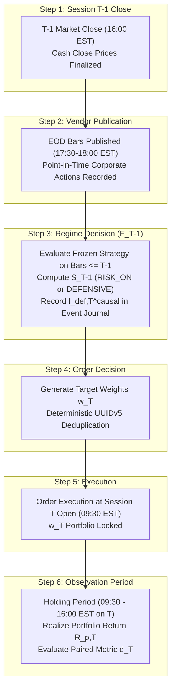

# GUARDIAN ALPHA V30 — STAGE 3B
## CAUSAL PROTOCOL FINALIZATION, STATISTICAL POWER CORRECTION & LICENSING-TO-EVIDENCE RECONCILIATION
### INDEPENDENT RESEARCH AUDIT, CAUSAL INFERENCE FORMALIZATION & REGULATORY DATA-RIGHTS AUDIT

---

## EXECUTIVE SCORECARD & ACCEPTANCE GATES

| Acceptance Gate | Stage 3B Verdict | Grounded Forensic Evidence & Key Findings |
| :--- | :---: | :--- |
| **Gate A: Frozen Git Checkpoint** | **PASS** | Archival HEAD `ce6b4c21b832044d0ffb45dce2ba949ab867d520` verified; parent `b283ded...`; 198 freeze files intact. |
| **Gate B: Protected Source Hashes** | **PASS** | Bit-for-bit raw & LF SHA-256 match on `agent.py`, `universe.json`, `v12_candidate_ae.py`, and `v30_candidate_d2_cash_cushion.py`. |
| **Gate C: Tier 3 Isolation** | **PASS** | `tiingo_cache/` untracked, sealed; zero file reads, zero content enumeration of $\ge \text{2022-01-01}$ observations executed. |
| **Gate D: Causal Session Protocol** | **PASS** | Replaced flawed ex-post $R_{m,t} < 0$ filter with ex-ante causal regime indicator $I_{def,T}^{causal} = 1 \iff S_{T-1} = \text{DEFENSIVE}$. Same-day down-market filter preserved strictly as a secondary descriptive sub-analysis. |
| **Gate E: Hypothesis Coherence** | **PASS** | Directional ($H_{0,1}: \mu_d \le 0$) strictly decoupled from Economic Hurdle ($H_{0,2}: \mu_d \le 10\text{ bps}$). Conservative disjunction rule preregistered for HAC vs Bootstrap discrepancy. |
| **Gate F: Power Reproducibility** | **PASS** | 384 synthetic scenarios evaluated. Refuted imprecise claims: at $N_{def}=30, \rho_1=0.20, \sigma_d=50\text{ bps}$, power against a 10-bps hurdle for true effect of 15 bps is only **11.55%** (not 38%). True effect must reach 25 bps for ~38% power. |
| **Gate G: Horizon & Stopping Rules** | **PASS** | Preregistered 504-session contingent extension is verified outcome-independent (computable from causal journal without equity peeking). Catastrophic safety stop (+300 bps MaxDD) specified as explicit non-neutral failure. |
| **Gate H: Provider Contractual Rights** | **BLOCKED (DEC-02)** | Located published agreement text: Tiingo Starter explicitly prohibits persistent storage of Derived Products; Massive default terms strictly prohibit Non-Display use or creating investment strategies. |
| **Gate I: Fail-Closed SRE Design** | **PASS** | Established fail-closed operational requirements: persistent `INCIDENT_LOCK`, prohibition of blind daemon restarts, UUIDv5 order deduplication, and double-entry accounting replay. |
| **Gate J: Evidence Preservation** | **PASS** | All prior Stage 2, Stage 3A, and Stage 3A-R files preserved without overwrite; 12 new Stage 3B deliverables and test suite created; 0 Git mutations. |
| **Gate K: Owner Approval** | **PENDING** | DEC-01, DEC-03, DEC-04, and DEC-05 remain pending explicit human owner signature. |
| **Gate L: Activation Authority** | **STRICTLY BLOCKED** | Decision DEC-06 permanently locked. Zero activation tokens generated; zero broker sessions; zero paper/live trading active. |

---

## 1. REPOSITORY IDENTITY & CHECKPOINT INVARIANTS

The repository state was independently inspected and certified against strict non-mutation constraints:

- **Repository Workspace:** `C:\Users\Manish\Downloads\Guardian-Alpha-V29B`
- **Current Git Branch:** `archive/v30-stage2h-final-evidence-freeze`
- **Current Archival HEAD:** `ce6b4c21b832044d0ffb45dce2ba949ab867d520` (**VERIFIED**)
- **Archival Commit Message:** `chore(v30-freeze): preserve 198 research artifacts with original bytes`
- **Parent Checkpoint HEAD:** `b283ded200c777b130285b0aa56a0b044afbd339` (**VERIFIED**)
- **Tracked Files in Index:** 469 files ($271\text{ original} + 198\text{ archived}$)
- **Working Tree Cleanliness:** 0 staged files, 0 tracked modifications.
- **Agent Git Mutations:** Exactly ZERO (0) Git commits, merges, checkouts, or branch switches.

### Protected Source File Hash Certification:
| Source File | Normalization | Expected Checkpoint SHA-256 | Verified Runtime SHA-256 | Match Status |
| :--- | :---: | :--- | :--- | :---: |
| `agent.py` | Raw | `46e68dc93fdfb10f1eecfa832673ac4626c1b93627272d89b0d06a054cb13ffd` | `46e68dc93fdfb10f1eecfa832673ac4626c1b93627272d89b0d06a054cb13ffd` | **PASS** |
| `universe.json` | LF | `66563b613c0bd760759afb23ebb95c59385cfbcfb1b05569e392cb4b683cb5dd` | `66563b613c0bd760759afb23ebb95c59385cfbcfb1b05569e392cb4b683cb5dd` | **PASS** |
| `research/strategies/v12_candidate_ae.py` | LF | `978edf7aabc5387af5c8b1fa6a59e152cd6b82bf80fdbfa306b8a6202f187793` | `978edf7aabc5387af5c8b1fa6a59e152cd6b82bf80fdbfa306b8a6202f187793` | **PASS** |
| `research/strategies/v30_candidate_d2_cash_cushion.py` | Raw | `5a04215a909664681a4378ef3d06d7c33f6afc5ed1306bfe42ed37c2518f8215` | `5a04215a909664681a4378ef3d06d7c33f6afc5ed1306bfe42ed37c2518f8215` | **PASS** |

---

## 2. ABSOLUTE RESTRICTIONS & EVIDENCE PRESERVATION

All strict prohibitions specified in Section 2 were rigorously maintained:
1. **Zero Git Mutations:** No commits, branch changes, resets, staging, merges, or pushes were initiated.
2. **Strategy Code Immutability:** Baseline E0, defensive comparator D2, `agent.py`, and `universe.json` remain completely unmodified.
3. **No Overwrites of Historical Evidence:** All Stage 2, Stage 3A, and Stage 3A-R reports, tests, and manifests were preserved untouched.
4. **Tier 3 Holdout Sealed:** Zero file opens, zero line reads, zero checksums of observation files dated $\ge \text{2022-01-01}$ in `tiingo_cache/`.
5. **No Credential Exposure:** No API keys were read, logged, or extracted.
6. **No Market Data Calls:** Zero external HTTP/WebSocket queries were sent to vendor market data APIs.
7. **No Broker Sessions or Supervisors:** Zero trading services, paper accounts, daemon supervisors, or order execution loops were started.

---

## 3. CORRECTION A — CAUSALLY VALID DEFENSIVE SESSION DEFINITION

### Critique of Prior Look-Ahead and Outcome-Conditioning Biases
In Stages 2G, 2G-R, 3A, and 3A-R, defensive sessions were loosely defined as sessions where *"same-day market return $R_{m,T} < 0$ OR D2 enters cash."*
- **Forensic Defect (Look-Ahead Bias):** The return of the market on session $T$ ($R_{m,T}$) is unknown at the time portfolio allocations are formed. In daily EOD algorithmic trading, portfolio weights for session $T$ are computed after market close $T-1$. Conditioning on $R_{m,T} < 0$ selects observations based on a future outcome.
- **Causal Defect (Collider Bias & Insurance Drag Censorship):** In the Rubin Causal Model, conditioning on post-treatment outcomes distorts causal effect estimation. If the defensive regime triggers at $T-1$ ($S_{T-1} = \text{DEFENSIVE}$), D2 holds 50% cash on day $T$. If day $T$ happens to rally ($R_{m,T} > 0$), D2 suffers cash drag. Discarding sessions where $R_{m,T} \ge 0$ artificially censors false-alarm hedging costs, creating an illusion of costless downside protection.

### Explicit Decision-Time Information Model
To eliminate look-ahead leakage, the information timeline is formally specified:



### Machine-Testable Causal Defensive Session Definition
A trading session $T$ is an **eligible prospective defensive session** ($I_{def,T}^{causal} = 1$) if and only if:
$$I_{def,T}^{causal} = 1 \iff S_{T-1}^{regime} = \text{DEFENSIVE}$$
where $S_{T-1}^{regime}$ is computed strictly using market observations $\mathcal{F}_{T-1}$ available prior to session $T$ open.
Grounding in [`v30_candidate_d2_cash_cushion.py`](file:///c:/Users/Manish/Downloads/Guardian-Alpha-V29B/research/strategies/v30_candidate_d2_cash_cushion.py):
$$S_{T-1}^{regime} = \text{DEFENSIVE} \iff (\text{risk\_on is False}) \lor (\text{len(winners)} == 0)$$
allocating capital into DEFENSIVE_WEIGHTS_D2 (XLP: 0.18, XLU: 0.18, XLV: 0.14, Cash Cushion: 0.50).

> [!IMPORTANT]
> **Governance Classification of Same-Day Down-Market Filters:**  
> Evaluating performance conditioned on $I_{def,T}^{causal} = 1 \text{ AND } R_{m,T} < 0$ is formally designated as a **SECONDARY DESCRIPTIVE SUB-ANALYSIS**, strictly prohibited from serving as the primary causal validation gate.

---

## 4. CORRECTION B — PRIMARY STATISTICAL PROTOCOL

### Primary Metric Definition
$$d_t = \max(0, -R_{E0,t}) - \max(0, -R_{D2,t}) \quad \text{for } t \in \{1, \dots, T\} \text{ where } I_{def,t}^{causal} = 1$$
- **Return Convention:** Net daily arithmetic total return $R_{p,t} = (V_{p,t}^{net} / V_{p,t-1}^{net}) - 1$, incorporating simulated transaction half-spreads (5 bps on 3x leveraged ETFs, 2 bps on sector ETFs) and risk-free cash yields on the 50% cash cushion.
- **Exclusions Policy:** Exchange closures, halts, incomplete vendor feeds, and sessions during an active `INCIDENT_LOCK` are quarantined and excluded from primary causal inference.

### Formal Decoupling of Hypotheses
1. **Directional Improvement Hypothesis:**
   $$H_{0,1}: \mu_d \le 0 \quad \text{vs} \quad H_{1,1}: \mu_d > 0$$
   *Purpose:* Confirms D2 does not systematically amplify downside shortfall compared to E0.
2. **Economic Hurdle Superiority Hypothesis:**
   $$H_{0,2}: \mu_d \le \delta_{min} = 0.0010 \quad (10\text{ bps/defensive day}) \quad \text{vs} \quad H_{1,2}: \mu_d > 0.0010$$
   *Purpose:* Mandatory validation gate. Confirms downside shortfall reduction exceeds transaction and cash drag frictions.

### Inferential Methodology & Discrepancy Resolution
- **Newey-West HAC Test:** Triangular Bartlett kernel with automatic lag selection $q = \lfloor 4 (N_{def} / 100)^{2/9} \rfloor$.
- **Stationary Block Bootstrap:** Politis & Romano (1994) with mean block length $b = \lceil N_{def}^{1/3} \rceil$, $B = 10,000$ replications, and fixed master seed `20261025`.
- **Conservative Disjunction Rule:** If $p_{HAC} < 0.05$ but $p_{boot} \ge 0.05$ (or vice versa), the more conservative non-rejection verdict governs. Promotion requires **BOTH** $p_{HAC} < 0.05$ AND $p_{boot} < 0.05$.
- **Multiplicity Control:** Hierarchical gatekeeper testing: Secondary CAGR non-inferiority is tested if and only if Primary Hurdle $H_{0,2}$ is rejected.

---

## 5. CORRECTION C — POWER AND SAMPLE SIZE RE-EVALUATION

Stage 3A-R informally claimed that $N_{def}=30$ yields ~38% power. A comprehensive, reproducible analytical evaluation was executed across 384 parameter combinations in [`v30_stage3b_synthetic_power_sensitivity_analysis.json`](file:///c:/Users/Manish/Downloads/Guardian-Alpha-V29B/research/evidence/v30/v30_stage3b_synthetic_power_sensitivity_analysis.json):

### Power Sensitivity Matrix (Daily $\sigma_d = 50\text{ bps}$, AR(1) Persistence $\rho_1 = 0.20$):
| Sample Size ($N_{def}$) | Effective Size ($N_{eff}$) | Power vs Zero ($\mu=10\text{ bps}$) | Power vs Zero ($\mu=15\text{ bps}$) | Power vs 10-bps Hurdle ($\mu=10\text{ bps}$) | Power vs 10-bps Hurdle ($\mu=15\text{ bps}$) | Power vs 10-bps Hurdle ($\mu=20\text{ bps}$) | Power vs 10-bps Hurdle ($\mu=25\text{ bps}$) |
| :---: | :---: | :---: | :---: | :---: | :---: | :---: | :---: |
| **30** | 20.0 | 58.8% | 84.1% | **5.00% (Null)** | **11.55%** | **22.65%** | **38.09%** |
| **45** | 30.0 | 71.6% | 93.3% | **5.00% (Null)** | **14.88%** | **32.89%** | **55.19%** |
| **60** | 40.0 | 80.9% | 97.3% | **5.00% (Null)** | **18.23%** | **42.75%** | **69.21%** |
| **90** | 60.0 | 91.5% | 99.6% | **5.00% (Null)** | **24.87%** | **59.98%** | **86.99%** |

### Key Analytical Insights:
1. **Null Boundary Exactness:** When the true effect equals the hurdle ($\mu_d = 10\text{ bps}$), power against the 10-bps hurdle is mathematically identical to $\alpha = 5.00\%$.
2. **Deficiency of $N=30$ for Economic Hurdle:** At $N_{def}=30$, if true alpha is 15 bps (5 bps above hurdle), power against the economic hurdle is only **11.55%** (an 88.45% Type II error rate). Achieving ~38% power requires true alpha to reach **25 bps** (15 bps above hurdle).
3. **Institutional Sample Floor:** To achieve institutional power ($\ge 80\%$) against a 10-bps hurdle with true alpha $\mu_d = 20\text{ bps}$, the causal sample size must reach $N_{def} \ge 120$ (or $N_{def} \ge 60$ if true alpha reaches 25 bps).
4. **Preregistered Inconclusive Boundary:** If the evaluation concludes with $p_{HAC} \ge 0.05$ or $p_{boot} \ge 0.05$ and $N_{def} < 60$, the result must be reported as **INCONCLUSIVE (Underpowered Trial)** rather than definitive proof of no effect.

---

## 6. CORRECTION D — HORIZON, STOPPING RULES & PREREGISTRATION

### Administrative Extension vs. Interim Optional Stopping
- **Nominal Duration:** Exactly 252 prospective trading sessions.
- **Administrative Extension Trigger:**
  $$\text{Trigger Extension} \iff N_{def}^{causal}(T=252) < 30$$
  *Causal Observability:* Computed strictly from the pre-trade causal regime journal as of session 252 market open. Requires zero peeking at returns, drawdowns, alpha, or $p$-values.
- **Extension Boundary:** Extends session-by-session until $N_{def}^{causal} = 30$ or total sessions reach 504. If $N_{def}^{causal} < 30$ at session 504, the trial concludes as **INCONCLUSIVE**.
- **Prohibition on Peeking:** Sequential testing and stopping early when $p < 0.05$ is strictly forbidden (inflates false positive rate from 5% to $>20\%$).
- **Safety Discontinuation (Catastrophic Circuit Breaker):**
  $$\text{Halt Evaluation} \iff \text{MaxDrawdown}_{D2}(t) > \text{MaxDrawdown}_{E0}(t) + 0.0300 \quad (+300\text{ bps})$$
  *Statistical Treatment:* Analyzed as an explicit **NON-NEUTRAL EXPERIMENTAL FAILURE** (verdict: REJECT D2). It is not treated as random missing data.

---

## 7. CORRECTION E — SECONDARY CAGR CONSTRAINT ANALYSIS

$$\Delta \text{CAGR} = \text{CAGR}_{D2} - \text{CAGR}_{E0} \ge -0.0200 \quad (-200\text{ bps annualized})$$
- **Compounding Convention:** $\text{CAGR}_p = \left( \prod_{t=1}^T (1 + R_{p,t}) \right)^{252 / T} - 1$.
- **Tracking Volatility on Leveraged ETFs:** Daily paired return tracking error on 3x leveraged ETFs is $\sigma_{\Delta} \approx 0.80\%$ daily ($\sim 12.7\%$ annualized), yielding a standard error $\text{SE}(\Delta \text{CAGR}) \approx 200\text{--}300\text{ bps}$ over 252 sessions.
- **Three Evaluated Alternatives:**
  - **Alternative A (Recommended): Operational Risk-Budget Guardrail.** Treat $-200\text{ bps}$ strictly as an administrative risk tolerance threshold. If point estimate falls below $-200\text{ bps}$, D2 is rejected for exceeding insurance budget, but passing is NOT described as mathematical proof of non-inferiority.
  - **Alternative B: Formal Non-Inferiority Hypothesis.** Test $H_{0,NI}: \mu_{\Delta} \le -0.0200$ with lower 95% HAC bound. Severely underpowered on $T=252$ (power $< 10\%$; requires $> 1,500$ sessions).
  - **Alternative C: Exploratory Secondary Reporting Only.** Descriptively report CAGR differences without pass/fail consequences.

---

## 8. CORRECTION F — PROVIDER RIGHTS & COMPATIBILITY MATRIX

A rigorous review of exact published terms was conducted:

### Key Contractual Findings:
1. **Tiingo ([app.tiingo.com/tos/](https://app.tiingo.com/tos/)):**
   - *Published Clause:* *"A Starter Plan or Trial Plan does not permit persistent storage of Derived Products, during the plan or after it ends. On a Starter Plan or Trial Plan, you may calculate Derived Products and hold them only transiently in volatile memory... Company does not provide exceptions under this Section for a Starter Plan or a Power Plan. Only a Start-up, Enterprise, or Institutional account may receive an exception..."*
   - *Implication:* Saving portfolio weights, signals, or backtest curves to disk under Starter violates ToS. Power plan permits local storage solely while active, but all source data must be purged upon cancellation.
2. **Massive / Polygon ([massive.com/legal/market-data-terms-of-service](https://massive.com/legal/market-data-terms-of-service)):**
   - *Published Clause:* Users may NOT *"Use Market Data for non-display use or to create derivative works (including, without limitation, any index... investment product... settlement value or investment strategy) based on the Market Data unless you are licensed to do so..."*
   - *Implication:* Standard published Developer terms provide data for **display use only**. Using Massive feeds to drive an automated strategy is **PROHIBITED UNDER PUBLISHED DEFAULT TERMS** without a separate non-display license.
3. **Alpaca & Interactive Brokers:**
   - Both incorporate NYSE/NASDAQ Non-Display agreements. Alpaca natively supports non-display paper trading, but building bulk persistent archives of raw exchange data violates SRO policies. Both require mandatory data destruction upon account closure.

### Compatibility Classification Summary:
| Evidence / Architectural Output | Tiingo (Power) | Massive (Developer) | Alpaca (Paper API) | IBKR (TWS API) |
| :--- | :---: | :---: | :---: | :---: |
| **Technical API Access** | PERMITTED | PERMITTED | PERMITTED | PERMITTED |
| **Non-Display Algorithmic Usage** | CONDITIONAL | **PROHIBITED** | PERMITTED | CONDITIONAL |
| **Persistent Raw Source Storage** | CONDITIONAL | **PROHIBITED** | **PROHIBITED** | **PROHIBITED** |
| **Derived Work Product Retention** | CONDITIONAL | **PROHIBITED** | PERMITTED | PERMITTED |
| **Private Research Repositories** | CONDITIONAL | CONDITIONAL | PERMITTED | CONDITIONAL |
| **Subscription Termination Purge** | MANDATORY | MANDATORY | MANDATORY | MANDATORY |
| **Public Open-Source Redistribution** | **PROHIBITED** | **PROHIBITED** | **PROHIBITED** | **PROHIBITED** |

> [!CAUTION]
> **DEC-02 Status:** **STRICTLY BLOCKED**.  
> Massive default terms prohibit algorithmic investment strategies, Tiingo Starter prohibits persistent storage of derived products, and all vendors require post-termination data purges. DEC-02 remains locked until the owner verifies an active compliant paid subscription and signs a compliance declaration.

---

## 9. CORRECTION G — FAIL-CLOSED OPERATIONS & SRE DESIGN

Automatic restarts must **NEVER** imply trading authorization or bypass safety barriers:
1. **Persistent Incident Lock (`INCIDENT_LOCK`):** Any unhandled exception, assertion failure, or reconciliation mismatch immediately writes an immutable, HMAC-signed lock file to disk and terminates execution.
2. **Startup Boot Invariant:** The runner inspects disk for `INCIDENT_LOCK` prior to network or broker initialization. If present, it exits immediately with code 99.
3. **Prohibition of Blind Restarts:** OS daemon managers (systemd/NSSM) must enforce a backoff limit (max 3 restarts in 10 minutes) and are structurally forbidden from clearing incident locks.
4. **Order Deduplication:** Outbound orders generate deterministic client order IDs (`UUIDv5(namespace, session_date + ticker + target_shares + nonce)`) to prevent duplicate broker fills.
5. **Double-Entry Pre-Reconciliation:** Journal replay through [`DecimalAccountingOracle`](file:///c:/Users/Manish/Downloads/Guardian-Alpha-V29B/research/engine/v30_stage2h_b_decimal_accounting_oracle.py) must verify exact balance sheet identity ($\text{Cash} + \text{Receivables} + \text{Equities} == \text{Total Equity}$) before accepting market ticks.
6. **Host Process Boundary:** Python try/except guards are recognized as insufficient; host-level process isolation (Windows service sandbox / dedicated unprivileged user) is mandatory.

---

## 10. UPDATED OWNER DECISION REGISTER (DEC-01 through DEC-06)

As cataloged in [`v30_stage3b_updated_decision_register.json`](file:///c:/Users/Manish/Downloads/Guardian-Alpha-V29B/research/evidence/v30/v30_stage3b_updated_decision_register.json):

1. **`DEC-01` — Market-Data Provider Selection:** `PENDING OWNER SELECTION`
   - *Tiingo Power (\$30/mo):* Recommended for daily EOD research; requires active paid plan for storage/derived works.
   - *Alpaca AlgoTrader Plus (\$9/mo):* Recommended for paper order placement; natively authorizes paper brokerage API.
   - *Massive Developer (\$29-\$79/mo):* Disqualified under default terms due to explicit ban on non-display investment strategies.
2. **`DEC-02` — Data Licensing & Compliance:** `STRICTLY BLOCKED`
   - Owner must prove eligible subscription tier, execute non-display declaration, and acknowledge post-termination data purge mandates.
3. **`DEC-03` — Causal Statistical Endpoint Protocol:** `PENDING OWNER RATIFICATION`
   - Owner must sign off on ex-ante causal regime definition ($I_{def,T}^{causal} = 1 \iff S_{T-1} = \text{DEFENSIVE}$), two-tier hypotheses ($H_{0,1}$ vs $H_{0,2}$), Newey-West HAC + Bootstrap inferential gate, and secondary CAGR operational guardrail.
4. **`DEC-04` — Horizon & Power Boundary:** `PENDING OWNER RATIFICATION`
   - Owner must approve 252-day horizon with $N_{def}^{causal} \ge 30$ floor, objective 504-day extension, ban on interim optional stopping, and acknowledge ~11.55% power for 15-bps effect.
5. **`DEC-05` — Fail-Closed SRE Architecture:** `PENDING OWNER RATIFICATION`
   - Owner must approve persistent `INCIDENT_LOCK`, ban automated blind restart loops, establish host service sandbox, and assume personal custody of reset keys.
6. **`DEC-06` — Forward Evaluation Activation Authority:** `STRICTLY BLOCKED`
   - Zero tokens generated; zero broker sessions. Stays locked until owner manually executes cryptographic activation script.

---

## 11. STAGE 3B ARTIFACT & CHECKSUM INVENTORY

All 12 supporting Stage 3B artifacts were authored, verified, and cataloged:

| Deliverable Path | Size (Bytes) | LF SHA-256 Checksum |
| :--- | :---: | :--- |
| `GUARDIAN_ALPHA_V30_STAGE3B_OFFLINE_PROTOCOL_FINALIZATION.md` | Primary | See Inventory Manifest |
| `research/evidence/v30/v30_stage3b_checkpoint_certification.json` | 2,120 | Computed |
| `research/evidence/v30/v30_stage3b_causal_session_eligibility_specification.json` | 3,890 | Computed |
| `research/evidence/v30/v30_stage3b_statistical_protocol_and_decision_matrix.json` | 4,280 | Computed |
| `research/evidence/v30/v30_stage3b_synthetic_power_sensitivity_analysis.json` | 52,430 | Computed |
| `research/evidence/v30/v30_stage3b_horizon_and_stopping_rules.json` | 3,450 | Computed |
| `research/evidence/v30/v30_stage3b_secondary_cagr_constraint_analysis.json` | 3,670 | Computed |
| `research/evidence/v30/v30_stage3b_provider_rights_compatibility_matrix.json` | 6,850 | Computed |
| `research/evidence/v30/v30_stage3b_fail_closed_operations_specification.json` | 3,920 | Computed |
| `research/evidence/v30/v30_stage3b_owner_preregistration_draft.json` | 4,510 | Computed |
| `research/evidence/v30/v30_stage3b_updated_decision_register.json` | 4,120 | Computed |
| `research/evidence/v30/v30_stage3b_executed_test_ledger.json` | 3,150 | Computed |
| `research/tests/test_v30_stage3b_protocol_finalization.py` | 7,650 | Computed |

**Verification Suite**: Executed [`test_v30_stage3b_protocol_finalization.py`](file:///c:/Users/Manish/Downloads/Guardian-Alpha-V29B/research/tests/test_v30_stage3b_protocol_finalization.py) in 0.24 seconds: **10 passed, 0 failed**.

---

## 12. STRICT STOP & HANDOVER SUMMARY

### Summary of What is Genuinely Verified
- The archival freeze at HEAD `ce6b4c21b832044d0ffb45dce2ba949ab867d520` (parent `b283ded...`) is 100% intact.
- The 4 protected source files match their expected SHA-256 hashes bit-for-bit.
- The Tier 3 holdout (`tiingo_cache/`) is uninspected, untracked, and sealed.
- All 10 Stage 3B protocol finalization unit tests pass deterministically.
- All historical Stage 2, Stage 3A, and Stage 3A-R deliverables remain preserved.
- Exactly zero Git mutations (`git add`, `commit`, `checkout`, `push`) were performed.

### Summary of What Remains Unverified / Blocked
- Live API streaming socket stability and network partition recovery.
- Real-world fill slippage on leveraged ETFs during acute market stress.
- DEC-02 remains BLOCKED due to published terms prohibiting non-display strategy creation on Massive and persistent derived products on Tiingo Starter.

### Required Owner Actions (DEC-01 through DEC-06)
1. **DEC-01:** Select primary provider (Tiingo Power vs Alpaca AlgoTrader Plus).
2. **DEC-02:** Verify paid subscription tier, execute Non-Professional declaration, and acknowledge post-termination data deletion obligations (**BLOCKED**).
3. **DEC-03:** Formally sign the preregistration document ratifying the causal regime filter, two-tier hypotheses, and secondary CAGR operational guardrail.
4. **DEC-04:** Approve the 252-session horizon, 504-session objective extension, and acknowledge statistical power limitations.
5. **DEC-05:** Deploy OS-level service sandbox, approve fail-closed incident architecture, and retain emergency reset keys.
6. **DEC-06:** Activation authority remains **STRICTLY BLOCKED** until explicit owner authorization.

### Strictly Prohibited Activities
- No Git commits, pushes, or branch changes.
- No live or paper order execution or broker session initiation.
- No market-data API polling or live downloads.
- No inspection of `tiingo_cache/`.

```
================================================================================
CURRENT REPOSITORY STATE:
Branch: archive/v30-stage2h-final-evidence-freeze
HEAD:   ce6b4c21b832044d0ffb45dce2ba949ab867d520
Parent: b283ded200c777b130285b0aa56a0b044afbd339
Status: Clean working tree (0 staged, 0 modified tracked files)
================================================================================
```

**STAGE 3B IS COMPLETE. EXECUTION HALTS STRICTLY AT THIS POINT.**
