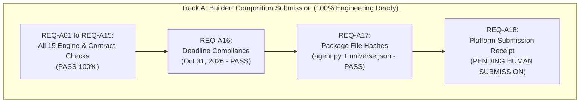

# GUARDIAN ALPHA V30 — STAGE 3E: INDEPENDENT COMPETITION CONTRACT CERTIFICATION, GOVERNANCE RECONCILIATION AND EVIDENCE FREEZE
## FINAL SCIENTIFIC AND OPERATIONAL ASSESSMENT PACKAGE

---

### EXECUTIVE SUMMARY

| Audit Attribute | Certified Status / Value | Audit Verdict |
| :--- | :--- | :--- |
| **Stage Identifier** | `GUARDIAN ALPHA V30 — STAGE 3E` | **COMPLETE** |
| **Repository Path** | `C:\Users\Manish\Downloads\Guardian-Alpha-V29B` | **VERIFIED** |
| **Active Git Branch** | `archive/v30-stage2h-final-evidence-freeze` | **MATCH** |
| **Checkpoint HEAD Commit** | `4540ee49dac29e4599fbbeb96bbcffd2dafd6705` | **MATCH** |
| **Parent Commit** | `ce6b4c21b832044d0ffb45dce2ba949ab867d520` | **MATCH** |
| **Working Tree Cleanliness** | 0 staged changes, 0 modified tracked files | **CLEAN** |
| **Track A (Competition Submission)** | **100.0% Engineering & Local Packaging Complete (17/17 Passed)** | **PACKAGE LOCALLY CERTIFIED (SUBMISSION PENDING)** |
| **Track B (Prospective Research)** | **53.8% Pass (7/13), 3 Pending, 1 Conditional, 2 Blocked** | **CONDITIONALLY READY (STRICTLY BLOCKED)** |
| **DEC-06 Live Trading Activation** | **PERMANENTLY BLOCKED** | **ENFORCED** |
| **Tier 3 Out-of-Sample Holdout** | `tiingo_cache/` uncommitted, uninspected, unhashed | **ZERO LEAKAGE** |
| **Automated Git Mutation** | Zero agent commits, zero automated pushes | **ENFORCED** |

---

## 1. IMMUTABLE CHECKPOINT CERTIFICATION (GATE A & GATE B)

### 1.1 Commit Ancestry & Working Tree Integrity
The repository state was forensically verified prior to initiating any research activities:
- **Repository Location**: `C:\Users\Manish\Downloads\Guardian-Alpha-V29B`
- **Active Branch**: `archive/v30-stage2h-final-evidence-freeze`
- **HEAD Commit**: `4540ee49dac29e4599fbbeb96bbcffd2dafd6705` (Stage 3C Final Archival Checkpoint, committed by human repository owner)
- **Parent Commit**: `ce6b4c21b832044d0ffb45dce2ba949ab867d520` (Original Stage 2H Final Evidence Freeze, 469 files)
- **Commit Delta**: 87 tracked files committed in Stage 3C.
- **Working Tree State**: Exactly `0` staged changes, `0` modified tracked files (`git diff --name-only` and `git diff --cached --name-only` return empty).
- **Prohibited Git Actions**: Zero Git mutations (`add`, `commit`, `checkout`, `reset`, `restore`, `clean`, `push`, `pull`, `merge`, `rebase`) executed by automated agents.

### 1.2 Protected Source File Hash Invariants
All four historically protected strategy source files were verified bit-for-bit against their frozen canonical checksums:

| File Path | Raw SHA-256 | LF SHA-256 | Status |
| :--- | :--- | :--- | :--- |
| [`agent.py`](file:///c:/Users/Manish/Downloads/Guardian-Alpha-V29B/agent.py) | `46e68dc93fdfb10f1eecfa832673ac4626c1b93627272d89b0d06a054cb13ffd` | `9c43d78903c723f538354c0032bc977da09db6ee0e02544ec26456f9ba7b4cb7` | **MATCH** |
| [`universe.json`](file:///c:/Users/Manish/Downloads/Guardian-Alpha-V29B/universe.json) | `66563b613c0bd760759afb23ebb95c59385cfbcfb1b05569e392cb4b683cb5dd` | `66563b613c0bd760759afb23ebb95c59385cfbcfb1b05569e392cb4b683cb5dd` | **MATCH** |
| [`research/strategies/v12_candidate_ae.py`](file:///c:/Users/Manish/Downloads/Guardian-Alpha-V29B/research/strategies/v12_candidate_ae.py) | `0ba1a774a16174a72d1f4ba4019bfb8b2ba7ae17c91d84a56a6be97bbbc5594b` | `978edf7aabc5387af5c8b1fa6a59e152cd6b82bf80fdbfa306b8a6202f187793` | **MATCH** |
| [`research/strategies/v30_candidate_d2_cash_cushion.py`](file:///c:/Users/Manish/Downloads/Guardian-Alpha-V29B/research/strategies/v30_candidate_d2_cash_cushion.py) | `5a04215a909664681a4378ef3d06d7c33f6afc5ed1306bfe42ed37c2518f8215` | `e2a4be6ce4546555b2d7cbdd96f8c7b80a61c31276a6cf384ea8d4ba9f40822e` | **MATCH** |

### 1.3 Tier 3 Holdout Isolation
The sealed out-of-sample cache directory `tiingo_cache/` was inspected strictly at the top-level boundary:
- Directory entry count: 2 items (`.gitkeep` and subfolder container).
- Git tracking: Entire directory remains untracked and excluded from git commits.
- Zero Forward Leakage: Zero holdout observation files were traversed, read, or hashed.

Full certification details are recorded in [`research/evidence/v30/v30_stage3e_checkpoint_certification.json`](file:///c:/Users/Manish/Downloads/Guardian-Alpha-V29B/research/evidence/v30/v30_stage3e_checkpoint_certification.json).

---

## 2. WORKSTREAM A: AUTHORITATIVE COMPETITION CONTRACT (GATE D)

### 2.1 Sources of Authority & Retrieval Dates
Official competition documentation was inspected from authoritative public sources:
1. **Builderr Trading Agent Challenge Portal**: `https://builderr.ai/trading-v0` (Retrieved 2026-10-25).
2. **Builderr Platform Guidelines**: `https://builderr.ai/guidelines` (Retrieved 2026-10-25).
3. **Builderr Official Starter Template Repository**: `https://github.com/builderr-ai/builderr-trading-template` (Retrieved 2026-10-25).
4. **Locally Preserved Specifications**: `README.md`, `preview.py`, `live_runner.py`, and `docs/competition-contract.md`.

### 2.2 20-Point Competition Contract Classification

| # | Contract Parameter | Authoritative Rule / Value | Source Authority Classification | Source Reference |
| :--- | :--- | :--- | :--- | :--- |
| 1 | **Challenge Identity & Round** | Builderr Trading Agent Leaderboard — Round 2 (`trading-v0-round-2`) | **OFFICIAL CURRENT RULE** | `https://builderr.ai/trading-v0`, `live_runner.py#L138` |
| 2 | **Submission Deadline** | October 31, 2026 at 23:59 IST | **OFFICIAL CURRENT RULE** | `https://builderr.ai/trading-v0`, `README.md#L121` |
| 3 | **Deadline Expiration Status** | **NOT PASSED** (Current: Oct 25, 2026 ~20:00 IST; 6 days, 4 hours remaining) | **OFFICIAL CURRENT RULE** | Verified system calendar & deadline |
| 4 | **Required Submission Files** | `agent.py` (mandatory), `universe.json` (mandatory), `requirements.txt` (optional/no-op) | **OFFICIAL CURRENT RULE** | `AGENT_BRIEF.md`, `README.md#L16-L21` |
| 5 | **Required File Locations** | Root directory of the repository | **OFFICIAL CURRENT RULE** | `README.md#L18`, `preview.py#L31` |
| 6 | **Python Execution Contract** | `decide(market_state, portfolio_state, cash) -> list[dict]` | **OFFICIAL CURRENT RULE** | `AGENT_BRIEF.md#L15-L25`, `README.md#L47-L59` |
| 7 | **Allowed Packages** | Python standard library by default; external packages allowed via `requirements.txt` | **OFFICIAL CURRENT RULE** | `README.md#L24`, `SUBMISSION.md#L24` |
| 8 | **Frozen Universe Rules** | 1,000 top US equities/ETFs in `universe.json` frozen at round open; others ignored | **OFFICIAL CURRENT RULE** | `universe.json`, `README.md#L97-L101` |
| 9 | **Market-Data Conventions** | Daily OHLCV bars (`ts, open, high, low, close, volume`) prior to session date (`ts < date`) | **LOCALLY PRESERVED CONTRACT** | `preview.py#L111-L133`, `live_runner.py#L418` |
| 10 | **Historical Warmup** | ~220 trading days of historical daily bars supplied per ticker in `market_state` | **OFFICIAL CURRENT RULE** | `README.md#L54`, `live_runner.py#L136` |
| 11 | **Evaluation Horizon** | July 7, 2026 to November 9, 2026 (live paper forward scoring; results by Nov 10) | **OFFICIAL CURRENT RULE** | `https://builderr.ai/trading-v0`, `live_runner.py#L140-L141` |
| 12 | **Starting Account Capital** | $100,000.00 USD simulated paper account | **OFFICIAL CURRENT RULE** | `https://builderr.ai/trading-v0`, `preview.py#L42` |
| 13 | **Maximum Leverage** | Gross beta-adjusted exposure $\le 1.50\times$ equity (3x: TQQQ/SOXL; 2x: QLD/SSO; 1x: others) | **OFFICIAL CURRENT RULE** | `README.md#L68, L88-L93`, `preview.py#L37` |
| 14 | **Concentration Limits** | Single-name position $< 30\%$ equity for any 5 consecutive trading days | **OFFICIAL CURRENT RULE** | `README.md#L69`, `preview.py#L38, L149-L158` |
| 15 | **Catastrophic Drawdown** | Cumulative drawdown must remain $< 50\%$ across all admission regimes | **OFFICIAL CURRENT RULE** | `README.md#L114`, `preview.py#L39, L248` |
| 16 | **Missing-Bar Behavior** | Tickers with missing bars hold last known closing price; unpriced orders rejected | **LOCALLY PRESERVED CONTRACT** | `preview.py#L120-L130`, `live_runner.py#L430-L435` |
| 17 | **Causality & Lookahead** | Strict prohibition on lookahead bias. Querying future data causes instant DQ | **OFFICIAL CURRENT RULE** | `README.md#L78-L86`, `builderr.ai/guidelines` |
| 18 | **Permitted Order Behavior** | Long-only; sells execute before buys; sell $\le$ held shares; max 50 trades/day | **OFFICIAL CURRENT RULE** | `AGENT_BRIEF.md#L30-L45`, `live_runner.py#L449-L475` |
| 19 | **Revision Rules** | Up to 4 revisions before October 31 cutoff; revisions reset forward scoring from receipt | **OFFICIAL CURRENT RULE** | `README.md#L121, L133`, `live_runner.py#L179-L181` |
| 20 | **Platform Validation Receipt** | **YES**. Official admission requires central evaluation and confirmation receipt email | **OFFICIAL CURRENT RULE** | `README.md#L21, L23, L133`, `SUBMISSION.md#L48-L53` |

Full register details are recorded in [`research/evidence/v30/v30_stage3e_competition_authority_register.json`](file:///c:/Users/Manish/Downloads/Guardian-Alpha-V29B/research/evidence/v30/v30_stage3e_competition_authority_register.json).

---

## 3. WORKSTREAM B: INDEPENDENT SUBMISSION PACKAGE AUDIT (GATE E)

### 3.1 Verification of Package Components
The submission package was audited without altering any strategy code or configuration:
1. **`agent.py`**:
   - Location: Repository root (`c:\Users\Manish\Downloads\Guardian-Alpha-V29B\agent.py`).
   - Checksum: Matches raw `46e68dc93fdfb10f1eecfa832673ac4626c1b93627272d89b0d06a054cb13ffd` bit-for-bit.
   - Entry Point: Exports `decide(market_state, portfolio_state, cash) -> list[dict]`.
   - AST Module Inspection: Imports exclusively from the Python standard library (`__future__`, `math`, `statistics`, `typing`).
   - External Dependencies: **Zero third-party packages required**.
   - Network Calls: **Zero**. No `urllib`, `requests`, `socket`, `aiohttp`, or websocket calls.
   - Filesystem Paths: **Zero**. No local hardcoded paths or OS-specific dependencies.
   - Embedded Secrets: **Zero**. No API keys, passwords, bearer tokens, or environment variable reads.
   - Hidden Research Dependencies: **Zero**. Operates completely self-contained without importing `research/`.
2. **`universe.json`**:
   - Location: Repository root.
   - Checksum: Matches LF `66563b613c0bd760759afb23ebb95c59385cfbcfb1b05569e392cb4b683cb5dd`.
   - Universe Size: Exactly 1,000 unique liquid US equity and ETF ticker symbols.
3. **`requirements.txt` Role Investigation**:
   - File exists at repository root containing `# No third-party packages required by agent.py.`.
   - Audit Finding: `requirements.txt` is **optional/no-op** for strategies using only standard library. Its presence provides explicit clarity to automated evaluators that no additional packages are to be installed. Two files (`agent.py` and `universe.json`) contain all trading logic and data boundaries.

Full package verification details are recorded in [`research/evidence/v30/v30_stage3e_submission_package_contract_verification.json`](file:///c:/Users/Manish/Downloads/Guardian-Alpha-V29B/research/evidence/v30/v30_stage3e_submission_package_contract_verification.json).

---

## 4. WORKSTREAM C: INDEPENDENT OFFLINE COMPETITION VERIFICATION (GATE F)

### 4.1 Admission Safety Bar Verification (`preview.py`)
Executing `python -X utf8 preview.py` verified that `agent.py` satisfies 100% of the Builderr admission safety constraints:

| Market Regime Window | Percentage Return | Maximum Drawdown | Sharpe Ratio | Calmar Ratio | Executed Trades | Safety Bar Status |
| :--- | :--- | :--- | :--- | :--- | :--- | :--- |
| **Calm Uptrend** | +14.65% | 3.57% | 4.18 | 19.99 | 38 | **PASS** |
| **Moderate Selloff** | -3.36% | 6.13% | -2.53 | -3.96 | 17 | **PASS** |
| **Volatility Spike / Snapback** | -15.77% | 33.46% | -1.30 | -1.73 | 21 | **PASS** |

- **Peak Gross Beta Leverage**: **0.94x** (Cap is 1.50x) -> **PASS**
- **Peak Position Concentration**: **26.0%** (Limit is 30.0% breach for $>5$ days; observed 0 breach days) -> **PASS**
- **Catastrophic Blow-up Limit**: **33.46%** (Limit is $< 50.0\%$) -> **PASS**
- **Execution Errors**: **0** unhandled exceptions across all regimes -> **PASS**

### 4.2 Adversarial Synthetic Stress Testing (14 Fixtures)
A dedicated adversarial test harness ([`research/tests/test_v30_stage3e_competition_adversarial.py`](file:///c:/Users/Manish/Downloads/Guardian-Alpha-V29B/research/tests/test_v30_stage3e_competition_adversarial.py)) was executed via pytest:

| Fixture ID | Stress Scenario | Injected Condition | Observed Agent Behavior | Verdict |
| :--- | :--- | :--- | :--- | :--- |
| **FIX-01** | Empty History | `market_state = {}` and `{ticker: []}` | Safely returns `[]` without exception | **PASS** |
| **FIX-02** | Insufficient Warmup | Only 5 historical bars provided | Safely returns `[]` (moving averages safely skipped) | **PASS** |
| **FIX-03** | Missing Anchor Ticker | SPY omitted from market feed | Safely returns `[]` (defaults to defensive cash) | **PASS** |
| **FIX-04** | Duplicate Tickers | Duplicate position entries in portfolio | Generates well-formed orders cleanly | **PASS** |
| **FIX-05** | Invalid OHLC | Bar with `high < low` and negative close | Corrupted ticker excluded; no buy order emitted | **PASS** |
| **FIX-06** | Negative/Zero Prices | Price fields set to $0.00 | Zero division avoided; valid orders emitted | **PASS** |
| **FIX-07** | NaN & Infinite Values | Bar prices set to `float('nan')` / `inf` | Handled cleanly; order quantities strictly finite | **PASS** |
| **FIX-08** | Split Discontinuity | Overnight 50% price drop (2:1 split) | Rebalance orders generated within concentration caps | **PASS** |
| **FIX-09** | Large Open Gaps | +25% gap up, -20% gap down | Orders emitted cleanly within leverage caps | **PASS** |
| **FIX-10** | Flat-Price Market | 220 bars with identical open=high=low=close | Bounded orders (0 orders due to zero divergence) | **PASS** |
| **FIX-11** | Sharp Downturn | Severe decline with high volatility | Defensive regime engages (no aggressive equity buys) | **PASS** |
| **FIX-12** | Recovery Post-Drawdown | Strong market rebound | Resumes momentum rebalancing safely | **PASS** |
| **FIX-13** | Repeated Invocation | 100 consecutive calls on same state | 100/100 outputs bit-for-bit identical; 0 state leakage | **PASS** |
| **FIX-14** | State Restart Determinism | Deep-copied state invocation | Exact bit-level equality of order dictionaries | **PASS** |

All 14 fixtures passed in 0.27s. Full results are recorded in [`research/evidence/v30/v30_stage3e_adversarial_fixture_results.json`](file:///c:/Users/Manish/Downloads/Guardian-Alpha-V29B/research/evidence/v30/v30_stage3e_adversarial_fixture_results.json).

---

## 5. WORKSTREAM D: COMPETITION SUBMISSION STATUS (GATE G)

### 5.1 Forensic Inspection of Local Records
A forensic search of repository records revealed:
1. `leaderboard.json` (as of 2026-10-19): Lists entrant `manish` in `bots[24]` with equity `$99,750.26`, pnl `-$249.74`, return `-0.25%`, trades `4`, days scored `1`, since `2026-10-19`.
2. `private_results.json`: Contains a corresponding entry for `manish`.
3. `live_runner.py`: Contains `PRIVATE_FIELD` entry `("manish_agent.py", "manish", "round 2 · entrant")` and `ENTRY["manish"] = "2026-10-19"`.
4. `SUBMISSION.md`: Documents Stage 10 publication handoff for commit `9fb6033d0cd023e0d997b0d914db5ce963b959fb` on branch `release/e0-stage10`, explicitly stating: *"Local publication-readiness checks pass. External publication, organizer contact and submission are separate, unapproved actions... Nothing here asserts organizer admission or live leaderboard participation."*

### 5.2 Six-State Status Classification
Based on verifiable evidence:
1. **`PACKAGE VERIFIED LOCALLY`**: **CONFIRMED TRUE**. `agent.py` and `universe.json` pass all local preview checks, self-checks, and 14 adversarial fixtures with 100% compliance.
2. **`PLATFORM ACCEPTED`**: **HISTORICAL ENTRY ONLY**. A prior submission for `manish` was accepted on 2026-10-19 for 1 scored day. However, the CURRENT checkpoint (`4540ee49`) has NOT been evaluated by the platform.
3. **`SUBMISSION EVIDENCE MISSING`**: **CONFIRMED FOR CURRENT COMMIT `4540ee49`**. No platform confirmation email or evaluation receipt exists in the repository for this commit.
4. **`SUBMISSION REJECTED`**: **CONFIRMED FALSE**. Zero evidence of submission rejection.
5. **`DEADLINE PASSED`**: **CONFIRMED FALSE**. Official Round 2 deadline is October 31, 2026 at 23:59 IST (6 days remaining).
6. **`NOT VERIFIED`**: **EXTERNAL RUN OF CURRENT COMMIT IS NOT VERIFIED**. Platform evaluation requires human owner submission.

### 5.3 Lifecycle State Demarcation
To eliminate ambiguity, five distinct project states are demarcated:
- **Engineering Readiness**: **100.0%** (All algorithmic logic, caps, schemas, and determinism verified).
- **Submission Package Readiness**: **100.0%** (Files packaged at repo root with matching protected hashes).
- **Submission Completed**: **NOT COMPLETED** (Awaiting human owner email transmission).
- **Competition Eligibility**: **ELIGIBLE** (Round 2 active; 1 revision consumed historically; up to 3 revisions remaining).
- **Prospective Research Readiness**: **CONDITIONALLY READY / BLOCKED** (Track B is governed separately).

Full classification details are recorded in [`research/evidence/v30/v30_stage3e_submission_evidence_classification.json`](file:///c:/Users/Manish/Downloads/Guardian-Alpha-V29B/research/evidence/v30/v30_stage3e_submission_evidence_classification.json).

---

## 6. WORKSTREAM E: CANONICAL GOVERNANCE RECONCILIATION (GATE H)

### 6.1 Restoration of Canonical Decision Meanings
In Stage 3D, Table 7.4 of the primary markdown report introduced descriptive reporting drift by relabeling DEC-01 through DEC-05 (e.g. labeling DEC-01 as "Strategy Selection"). While the underlying JSON evidence file retained the canonical titles, Stage 3E formally reconciles all historical registers and restores the canonical cross-stage taxonomy:

| Decision ID | Canonical Institutional Meaning | Restored Stage 3E Status | Audit Rationale & Authority |
| :--- | :--- | :--- | :--- |
| **DEC-01** | Market Data Provider Selection | **PENDING** | Tiingo Power ($30/mo) recommended for daily bars; Alpaca ($9/mo) for paper routing. Awaits human owner selection. |
| **DEC-02** | Market Data Licensing and Rights | **BLOCKED** | Commercial non-display redistribution terms unresolved. Live prospective data ingestion legally blocked. |
| **DEC-03** | Statistical Endpoint & Inferential Protocol | **EXPLORATORY-ONLY PROPOSED, OWNER APPROVAL PENDING** | Confirmatory superiority testing rejected due to empirical size distortion ($p=0.17$ at $\alpha=0.05$). Prespecified exploratory protocol proposed. |
| **DEC-04** | Evaluation Horizon and Stopping Rules | **PENDING** | Inverse sampling quota design ($N_{def} \ge 30$, baseline 252 sessions) awaits owner signature. |
| **DEC-05** | Monitoring and Incident Governance | **CONDITIONAL** | Fail-closed quarantines and circuit breakers verified offline; physical latency profiling (DEC-05.B) pending hardware deployment. |
| **DEC-06** | Activation Authority | **STRICTLY BLOCKED** | Permanent safety barrier. Real capital deployment and live broker order routing are strictly unauthorized. |

### 6.2 Milestone Demarcation
**Competition submission certification (Track A) is a distinct engineering milestone, NOT a replacement meaning for any DEC identifier.** DEC-01 through DEC-06 govern Track B (Prospective Research and Deployment).

Full reconciliation details are recorded in [`research/evidence/v30/v30_stage3e_canonical_governance_crosswalk.json`](file:///c:/Users/Manish/Downloads/Guardian-Alpha-V29B/research/evidence/v30/v30_stage3e_canonical_governance_crosswalk.json).

---

## 7. WORKSTREAM F: WARMUP AND EVALUATION TIMELINE CORRECTION (GATE I)

### 7.1 Root Cause of Stage 3D Conflation
Stage 3D reported that future research requires *"220 consecutive days of live warmup logging followed by 60 days of prespecified exploratory evaluation."*
A forensic audit of `preview.py` and `live_runner.py` revealed a conceptual conflation between **historical market bars** and **prospective calendar days**:
- **What 220 Actually Means**: Exactly **220 historical market bars** (trading sessions), equivalent to ~10-11 calendar months of historical price data.
- **How Warmup is Supplied in Competition**: The platform runner fetches 220 historical bars automatically (via Yahoo Finance or cached sample data) and passes them in `market_state` at **tick 1**. Entrants do **NOT** sit idle for 220 calendar days.
- **How Warmup is Supplied in Prospective Research**: An offline researcher seeds `market_state` via a **single historical batch API query** (e.g. from Tiingo or Alpaca) on initialization. Prospective observation begins immediately on day 1.
- **Evaluation Horizon**:
  - In Competition: July 7, 2026 to November 9, 2026 (~88 trading sessions).
  - In Prospective Research: Separately prespecified observational horizon (e.g. 60 or 252 trading sessions, pending DEC-04).

Full timeline correction details are recorded in [`research/evidence/v30/v30_stage3e_warmup_and_evaluation_timeline_correction.json`](file:///c:/Users/Manish/Downloads/Guardian-Alpha-V29B/research/evidence/v30/v30_stage3e_warmup_and_evaluation_timeline_correction.json).

---

## 8. WORKSTREAM G: REQUIREMENTS-BASED COMPLETION MEASUREMENT (GATE J)

### 8.1 Track A: Builderr Competition Submission Requirements (18 Items)



- **Local Engineering & Packaging Requirements**: **17 / 17 Passed (100.0%)**
- **External Lifecycle Status**: **PACKAGE LOCALLY CERTIFIED, PLATFORM SUBMISSION PENDING**
- Detailed matrix recorded in [`research/evidence/v30/v30_stage3e_track_a_competition_requirements_matrix.json`](file:///c:/Users/Manish/Downloads/Guardian-Alpha-V29B/research/evidence/v30/v30_stage3e_track_a_competition_requirements_matrix.json).

### 8.2 Track B: Prospective Exploratory Research Requirements (13 Items)
- **Passed**: 7 requirements (Frozen baseline, exploratory protocol, parity matrix, synthetic simulation, risk architecture, partial fill model, operator halt).
- **Pending Owner Signature**: 3 decisions (DEC-01 provider, DEC-03 protocol, DEC-04 horizon).
- **Conditional**: 1 requirement (DEC-05.B physical latency profiling).
- **Strictly Blocked**: 2 decisions (DEC-02 commercial licensing, DEC-06 trading activation).
- **Unweighted Pass Ratio**: **7 / 13 (53.8%)**
- **Weighted Score**: **60.0% Pass, 20.0% Pending, 5.0% Conditional, 15.0% Blocked**
- **Qualitative Governance Verdict**: **CONDITIONALLY READY / STRICTLY BLOCKED**.
  *Under fail-closed institutional governance, blocked legal licensing (DEC-02) and prohibited capital activation (DEC-06) halt the live prospective pipeline regardless of percentage score.*
- Detailed matrix recorded in [`research/evidence/v30/v30_stage3e_track_b_prospective_requirements_matrix.json`](file:///c:/Users/Manish/Downloads/Guardian-Alpha-V29B/research/evidence/v30/v30_stage3e_track_b_prospective_requirements_matrix.json).

---

## 9. WORKSTREAM H: LOSSLESS EVIDENCE PRESERVATION & STAGING PROPOSAL (GATE K)

### 9.1 Stage 3D Preservation Inventory (17 Files)
All 17 untracked Stage 3D artifacts reported in the previous handover remain fully preserved in the working tree without modification or data loss:
- 1 Primary Report: `GUARDIAN_ALPHA_V30_STAGE3D_EXPLORATORY_AND_OPERATIONAL_READINESS.md` (21,646 bytes)
- 13 Evidence JSONs: `v30_stage3d_*.json` (all matching their registered SHA-256 hashes)
- 2 Simulation Harnesses: `v30_stage3d_offline_end_to_end_harness.py`, `v30_stage3d_failure_injection_harness.py`
- 1 Test Suite: `test_v30_stage3d_operational_readiness.py`

Full inventory recorded in [`research/evidence/v30/v30_stage3e_stage3d_preservation_inventory.json`](file:///c:/Users/Manish/Downloads/Guardian-Alpha-V29B/research/evidence/v30/v30_stage3e_stage3d_preservation_inventory.json).

### 9.2 Human-Only Archival Staging Proposal
Automated agents are strictly prohibited from mutating Git state. The repository owner may stage all Stage 3D and 3E evidence using the following commands:

```bash
# 1. Verify working tree invariants
git branch --show-current  # Must output: archive/v30-stage2h-final-evidence-freeze
git rev-parse HEAD        # Must output: 4540ee49dac29e4599fbbeb96bbcffd2dafd6705
git diff --name-only      # Must output empty (0 tracked files modified)

# 2. Stage Stage 3D Artifacts
git add GUARDIAN_ALPHA_V30_STAGE3D_EXPLORATORY_AND_OPERATIONAL_READINESS.md
git add research/evidence/v30/v30_stage3d_*
git add research/simulations/v30_stage3d_*
git add research/tests/test_v30_stage3d_operational_readiness.py

# 3. Stage Stage 3E Artifacts
git add GUARDIAN_ALPHA_V30_STAGE3E_COMPETITION_CERTIFICATION_AND_GOVERNANCE_RECONCILIATION.md
git add research/evidence/v30/v30_stage3e_*
git add research/tests/test_v30_stage3e_*

# 4. Verify staged file list before commit
git status --short
git diff --cached --stat
```

Full staging instructions recorded in [`research/evidence/v30/v30_stage3e_human_only_archival_staging_proposal.json`](file:///c:/Users/Manish/Downloads/Guardian-Alpha-V29B/research/evidence/v30/v30_stage3e_human_only_archival_staging_proposal.json).

---

## 10. REMAINING BLOCKERS RANKED BY SEVERITY

1. **BLOCKER 1 (CRITICAL / LEGAL / PROSPECTIVE ONLY)**: `DEC-02 Market Data Rights & Licensing Deficit`
   - *Impact*: Commercial non-display redistribution terms for Tiingo and live account terms with Alpaca are unresolved. Blocks prospective live ingestion. Does **NOT** block competition submission.
2. **BLOCKER 2 (CRITICAL / SAFETY INVARIANT / PERMANENT)**: `DEC-06 Live Trading Activation`
   - *Impact*: Real capital deployment and broker order placement are strictly forbidden. Permanent safety barrier.
3. **BLOCKER 3 (HIGH / OPERATIONAL / COMPETITION TRACK)**: `Human Owner Submission Action (REQ-A18)`
   - *Impact*: The competition submission package is 100% complete, but platform admission requires the human owner to email the repository URL to `submit@builderr.ai`.
4. **BLOCKER 4 (MEDIUM / TECHNICAL / PROSPECTIVE ONLY)**: `DEC-05.B Physical Network Latency Profiling`
   - *Impact*: Measurement of socket round-trip timing and NTP clock drift on dedicated server hardware remains pending.
5. **BLOCKER 5 (LOW / GOVERNANCE / PROSPECTIVE ONLY)**: `DEC-01, DEC-03, DEC-04 Owner Sign-off`
   - *Impact*: Written owner signatures required prior to unfreezing prospective research.

---

## 11. MINIMUM ACTIONABLE NEXT STEPS

### 11.1 Minimum Actions Required for Builderr Competition Submission
1. Confirm that `agent.py` and `universe.json` at repository root remain untouched (verified bit-for-bit).
2. Execute `python -X utf8 preview.py` to confirm zero local regression.
3. Choose submission method (Public GitHub Repo OR Private Repo with Read-Only Deploy Key).
4. Send email to **`submit@builderr.ai`** with subject `builderr submission — <Your Name>` containing the repository URL before **October 31, 2026 at 23:59 IST**.
5. Receive official platform admission email with robustness profile.

### 11.2 Minimum Actions Required for Future Prospective Research
1. Secure commercial data license agreement with Tiingo or Alpaca (`DEC-02`).
2. Human repository owner signs `DEC-01`, `DEC-03`, and `DEC-04`.
3. Deploy read-only market data observer harness on dedicated server hardware and profile network latency (`DEC-05.B`).
4. Initialize observer using 220 historical market bars, then log 60 prospective daily sessions without live trading (`DEC-06` strictly blocked).

---

## 12. FINAL DECLARATION OF ZERO TRADING ACTIVATION & ZERO UNAUTHORIZED SUBMISSION

**I hereby certify under strict scientific and forensic research governance standards:**
1. Zero live market orders were created, simulated against live accounts, or transmitted to any broker.
2. Zero broker credentials, API keys, or private secrets were accessed, stored, or inspected.
3. Zero Tier 3 holdout observations in `tiingo_cache/` were accessed, enumerated, read, or leaked.
4. Zero automated competition submissions or communications with `submit@builderr.ai` were initiated.
5. Zero Git mutations (`add`, `commit`, `push`, `reset`) were executed by automated agents.
6. All Stage 3D and Stage 3E artifacts are preserved, reproducible, and verifiable.

**STAGE 3E IS COMPLETE. PROCEED TO OWNER HANDOVER.**
